# 숨 (Soom)

기침하는 사람이 탄 자리를 누르면, 차가 먼저 묻고 바깥 공기로 바꿔 같이 탄 사람의 추정 감염 위험을 줄이는 Pleos Connect 앱입니다. 같은 엔진이 탁한 공기, 미세먼지, 앉은 시간도 자리마다 챙깁니다.

- 소개 페이지(영상 바로 재생, 브라우저 체험): https://soom-pleos.github.io/soom/
- 시연 영상(2분 5초): [docs/demo/soom_demo.mp4](docs/demo/soom_demo.mp4)
- 숏폼(57초, 세로): [docs/demo/soom_short.mp4](docs/demo/soom_short.mp4)
- APK: [apk/안준영_숨_release.apk](apk/) (v0.8.0, 설치 방법은 아래 "APK" 절)
- 브라우저에서 바로 보기: `docs/sim/index.html`

## v0.8.0 핵심: 기침해요 자리

정차 중에 좌석 지도의 자리를 눌러 "기침해요"를 고르면, 그 자리와 다른 사람이 같이 탔을 때 CO2 한도를 기다리지 않고 출발 직후 묻습니다. "기침하는 자리가 있어요. 다른 자리로 숨이 덜 가게 바깥 공기로 계속 둘까요?" 동의하면 내기순환을 끄고 외기를 유지합니다. 밖 미세먼지가 나쁜 날에는 약한 바람으로 바깥 공기를 계속 들이자고 묻습니다. 도착 카드에는 "기침 자리와 같이 탄 3명, 추정 감염 위험 38%"와 "내내 내기였다면 99.9%"가 나란히 남습니다.

계산은 실제 승용차의 공기 교환율을 재서 인플루엔자 공기 전파 위험을 구한 Knibbs, Morawska, Bell (2012, Epidemiology and Infection 140(3))의 Wells-Riley 식을 그대로 씁니다(`engine/.../InfectionModel.kt`). 같은 논문의 2005년형 골프 값(실내 3.88㎥, 100km/h 에서 내기 2.7회/h, 외기 1단 57.8회/h), 독감 q 67 quanta/h, 호흡 0.6㎥/h 로 90분을 계산하면 다음과 같습니다. 엔진 테스트(`CoughTest`)가 논문 표의 90분 값(98%, 24%, 17%)을 1.5%p 안에서 다시 내는지 확인합니다.

| 90분, 기침 1명과 같이 탄 3명 | 내기순환 그대로 | CO2 만 보고 가끔 환기 (5분 내기, 2분 외기) | 숨: 바깥 공기 계속 |
|---|---|---|---|
| 한 명의 추정 감염 위험 | 98.7% | 59.8% | 23.4% |
| 셋 중 기대 감염자 수 | 2.96명 | 1.79명 | 0.70명 |

가끔 환기만으로는 위험이 60% 가까이 남습니다. 그래서 기침 자리가 있으면 짧게 여러 번이 아니라 계속 바깥 공기를 들입니다. 전부 공기가 고루 섞인다고 본 추정치이고, 의학적 효과를 보장하지 않습니다. 앱 기본값(실내 3.0㎥, 풍량 3단)으로 계산하는 도착 카드 숫자는 논문 차량 값과 조금 다릅니다. 근거와 한계는 `docs/EVIDENCE.md` 의 "K" 절에 있습니다.

| 자리 설정: 기침해요 | 출발 직후 먼저 묻기 | 도착 카드 |
|---|---|---|
| 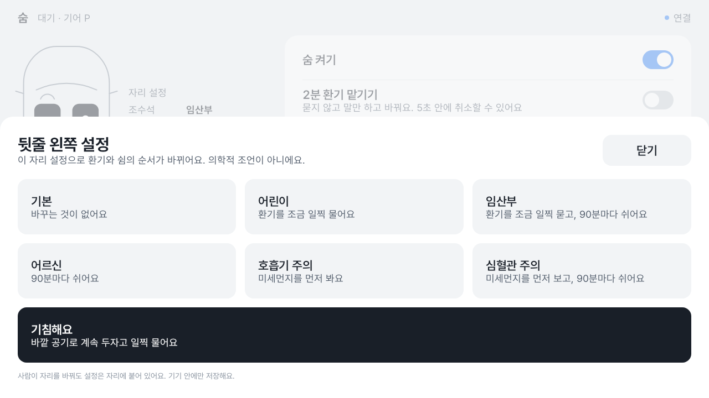 | 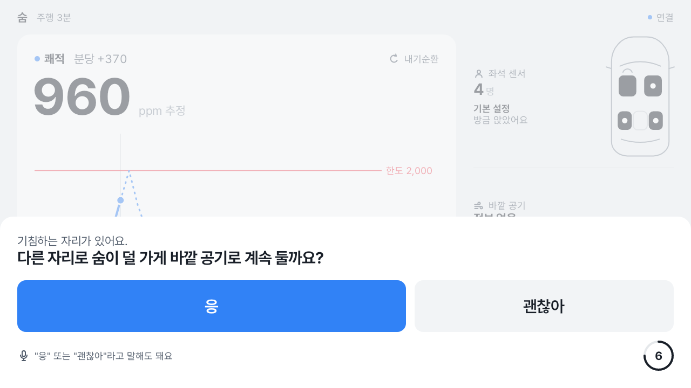 | 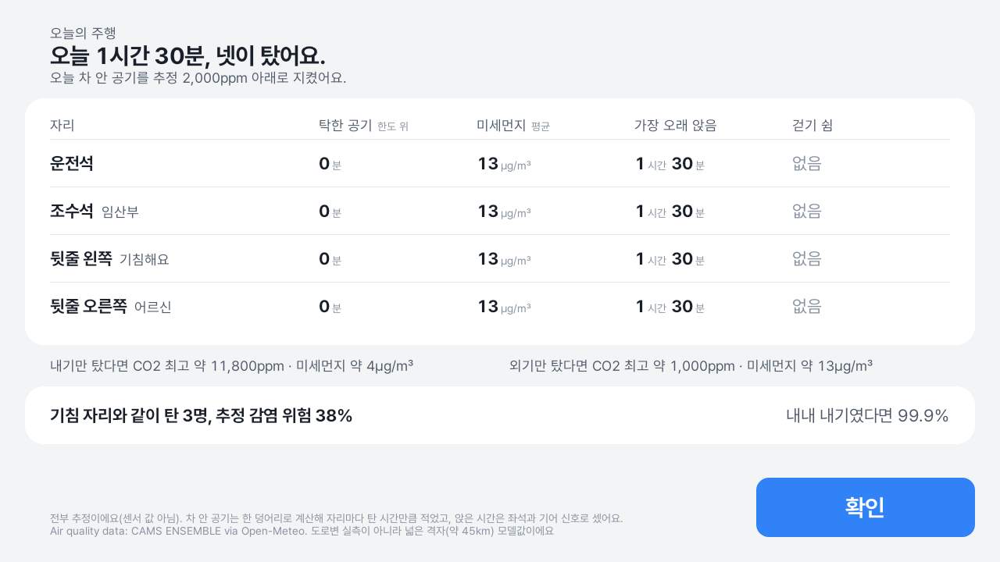 |

## 그 밖의 기능

몸을 재지 않고, 몸에 쌓이는 것을 줄입니다. 자리별로. 차 안의 탁한 공기, 미세먼지, 앉아 있는 시간을 추정해 먼저 묻고, 바꾸고, 되돌리는 Pleos Connect 앱입니다.

v0.7.3 에서 축을 "졸음"에서 "차 안에서 몸에 쌓이는 것"으로 옮겼습니다. 숨은 심박을 읽지 않고 차를 세우지도 않습니다(Pleos SDK 로는 할 수 없고, 그 일은 제조사가 이미 합니다). 그 대신 쌓이는 것 셋을 자리별로 적고 줄입니다. 탄 사람 수로 추정한 실내 CO2, 바깥 값으로 추정한 실내 미세먼지, 좌석과 기어 신호로 센 앉은 시간입니다. 정차 중에 좌석 지도의 자리를 눌러 그 자리의 설정(기본, 어린이, 임산부, 어르신, 호흡기 주의, 심혈관 주의)을 고르면 환기와 쉼의 순서와 여유가 바뀝니다. 어린이나 임산부 자리에 사람이 타면 환기를 한도의 90%에서 조금 일찍 묻고("어린이 자리가 있어 조금 일찍 물어요."), 호흡기 주의나 심혈관 주의 자리에 사람이 타면 바깥 미세먼지 등급을 한 단계 나쁘게 보고 환기를 늦추고 짧게 합니다("밖 미세먼지가 보통이지만 호흡기 주의 자리가 있어 1분 30초만 짧게 바꿀까요?"). 어떤 조합에서도 CO2 기본 한도(2,000ppm)는 넘기지 않습니다. 한 자리의 연속 착석이 120분(임산부, 어르신, 심혈관 주의 자리가 타면 90분)에 닿으면 "두 시간째 앉아 있어요. 12km 앞 경부선 석적 졸음쉼터에서 내려서 5분 걸을까요?"를 묻고, 동의하면 쉼터만 경유지에 넣습니다. 도착 카드는 자리마다 한 줄로 탁한 공기에 있던 시간, 미세먼지 평균, 가장 오래 앉은 시간, 걷기 쉼을 적습니다. 이 설정은 의학적 조언이 아닙니다. 프로필별 숫자를 뒷받침하는 문헌은 확인하지 못했고, 그래서 기준이 아니라 순서와 여유를 바꾸는 설정으로 만들었습니다. 설정은 사람이 아니라 자리에 붙고 기기 안에만 저장합니다. 빈자리의 설정은 쓰지 않습니다. 설정이 전부 기본이면 판단은 v0.7.2 와 같습니다. 근거와 한계는 `docs/EVIDENCE.md` 의 "J. 몸에 쌓이는 것" 절에 있습니다.

핵심은 숨 모델입니다. CO2 센서 없이 탑승 인원(좌석 점유, 안전벨트), 내기·외기, 풍량, 창문 상태로 실내 이산화탄소를 추정하고, 추정치가 한도(2,000ppm)에 닿으면 짧게 묻고 답을 기다립니다. 화면의 ppm 은 전부 추정값이고 센서 값이 아닙니다. 같은 차, 같은 내기순환이라도 1명이면 약 20분, 4명이면 약 4분 만에 한도에 닿습니다(기본값 계산). 그래서 권하는 말도 인원에 따라 다릅니다. 혼자면 "2분만 바깥 공기로 바꿀까요?" 하고 2분 뒤 되돌리고, 여럿이면 "바깥 공기로 바꿔 둘까요?" 하고 그대로 둡니다.

처음에는 매번 묻습니다. "2분만" 환기에 세 번 연속 "응" 하면 도착 카드에서 한 번 묻습니다. "다음부터 2분 환기는 말만 하고 바꿀까요?" 맡기면 그 뒤로는 "2분만 바깥 공기로 바꿀게요. 싫으면 '아니'라고 하세요." 하고 5초 뒤에 바꿉니다. 동의를 없애는 게 아니라 동의의 단위를 건별에서 범위가 정해진 맡김으로 바꾼 것입니다. 예고와 취소는 남습니다.

v0.7.0 에서 "숨 설계"를 더했습니다. 내기만 쓰면 CO2 가 쌓이고, 외기만 쓰면 미세먼지가 들어옵니다. 숨은 둘 사이에서 덜 손해 보는 때와 길이를 고릅니다. 바깥 초미세먼지(PM2.5)가 나쁨 이상인 날에는 일찍 묻지 않고 한도에 닿을 때까지 기다렸다가, 필요한 만큼만(1분, 1분 30초, 2분 가운데 계산한 길이) 바꾸고 되돌립니다. "밖 미세먼지가 나쁨이라 1분만 짧게 바꿀까요?"처럼 실제로 계산한 길이를 말합니다. 홈 화면의 숨 곡선은 지나온 추정 CO2 곡선, 같은 조건으로 내내 내기만 썼다면의 그림자 곡선, 한도선, 앞으로의 예보를 그리고, 오른쪽 "바깥 공기" 행이 "미세먼지 나쁨 41"과 "약 6분마다 1분 30초"를 보여 줍니다(v0.7.0 의 숨 설계 카드를 v0.7.1 에서 이렇게 옮겼습니다). 도착 카드는 내기만, 외기만, 이번 주행 세 갈래의 CO2 최고값과 미세먼지 노출을 막대로 견줍니다. 쉼터에서는 "커피 한 잔 뒤 15분 안쪽으로 눈을 붙이면 도움이 된다는 연구가 있어요."를 보여 주고 15분 뒤 알립니다. 전부 추정이고, 바깥 미세먼지 값은 도로변 실측이 아니라 넓은 격자(약 45km) 모델값입니다. 값을 받지 못하거나 설정에서 끄면 v0.6.2 와 똑같이 CO2 추정만으로 판단합니다. Air quality data: CAMS ENSEMBLE via Open-Meteo. 근거와 한계는 `docs/EVIDENCE.md` 의 "I. 숨 설계 근거" 절에 있습니다.

같은 방식의 두 번째 쓰임이 졸음 경고입니다. 차의 운전자 주의 경고가 뜨면 찬 바람과 같은 방향 졸음쉼터 경유를 묻고, 쉼터에서 쉰 시간을 셉니다.

신호 → 판단 → 짧은 질문(맡긴 뒤에는 예고) → 동의 → 차량 제어 → 원복 → 쉼 모드와 도착 카드. 이 체인이 앱의 전부입니다. 새로운 발상이라고 말하지 않습니다. 현대모비스는 2022년에 스마트캐빈 제어기를 발표했습니다. 심전도, 뇌파, 3D 카메라, 이산화탄소 센서의 값을 분석하고 이산화탄소가 높으면 창문을 열거나 외기 순환으로 바꿉니다. 현대차·기아의 미국 특허 US 11,565,573 은 센서로 실내 이산화탄소와 오염물질을 재서 내기와 외기를 자동으로 바꿉니다. 우리는 센서 없이, 쌓이기 전에, 자리별로, 묻고 되돌립니다. 그 밖에도 시간 기준 자동 환기(기아), 졸음 뒤 공조 자동 조절(Voyah), 휴게소 검색 제안(메르세데스), 인원 기반 CO2 추정 특허 출원(2018)이 이미 있습니다. 앞의 셋과 특허는 처음부터 묻지 않고 바꿉니다. 숨은 건별 동의에서 시작해 사용자가 맡길 때만 예고로 바뀌고, 탄 사람 수에 따라 다르게 권하고, 끝나면 되돌립니다. 근거와 선행 사례는 `docs/EVIDENCE.md` 에 있습니다.

현대자동차그룹 차량용 앱 개발 공모전 출품작. 개인 참가. 해외 독자용 요약은 `docs/PITCH_EN.md`.

| 주행 중 홈 (숨 곡선, 좌석 지도, 바깥 공기, 다음 쉼터) | 환기 제안 (아래에서 올라오는 시트, 버튼 둘) |
|---|---|
| 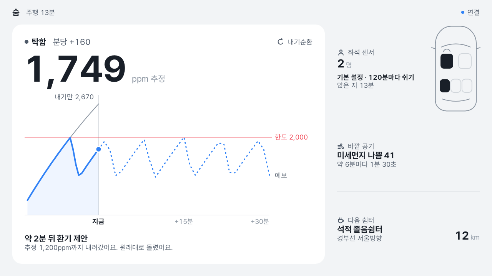 | 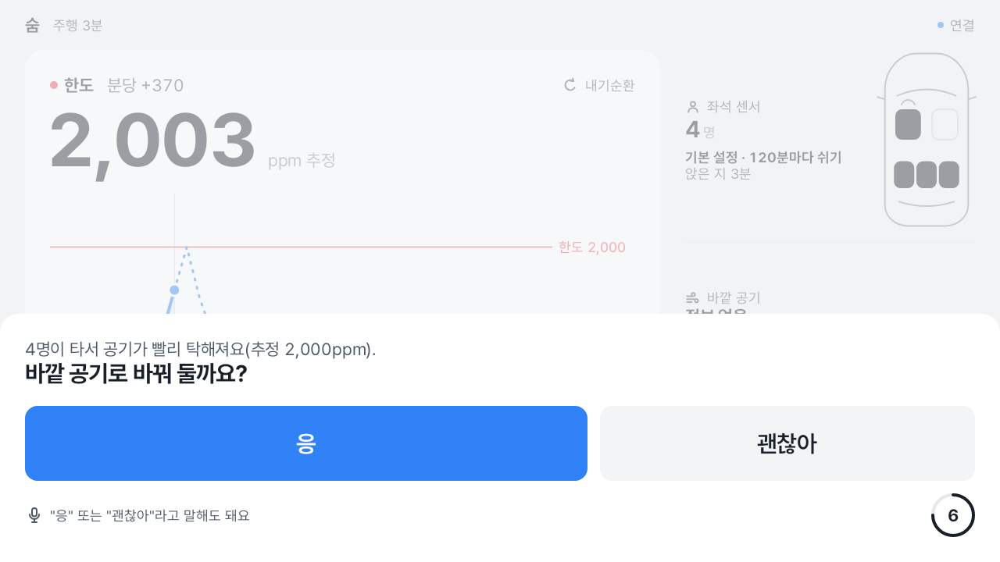 |
| **밤 테마** (시스템 야간 모드를 따라 바뀜) | **실행 중** (위 막대 아래 진행 띠, 곡선이 내려감) |
| 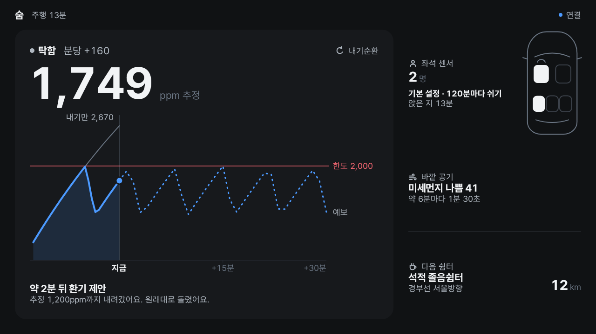 | 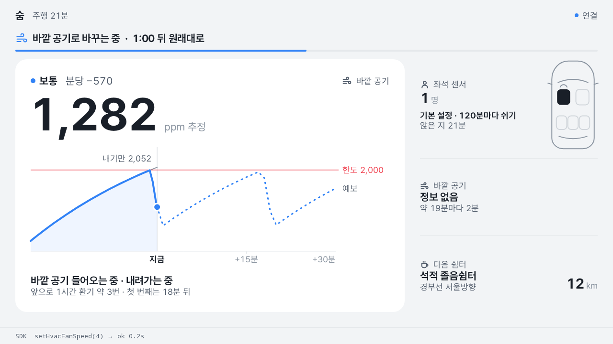 |
| **도착 카드** (자리마다 한 줄, 아래에 접은 세 갈래 한 줄) | **쉼 모드** (원형 타이머, 쉬는 동안 바깥 공기 질문) |
| 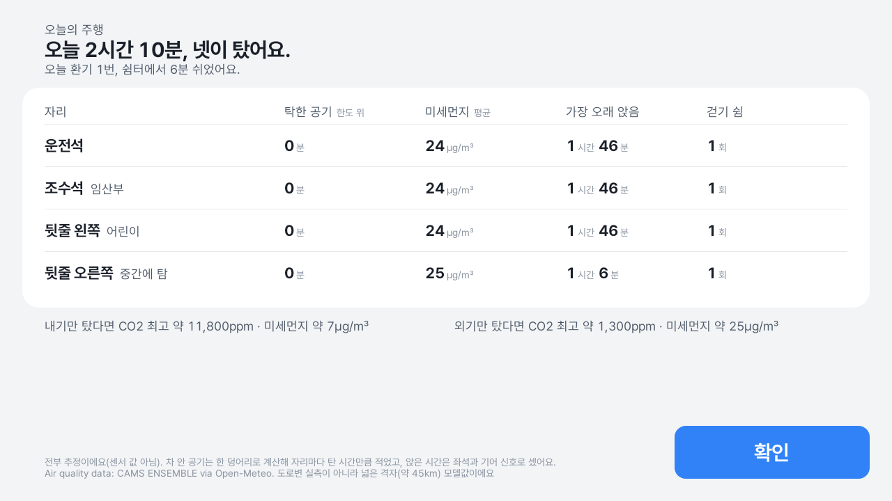 | 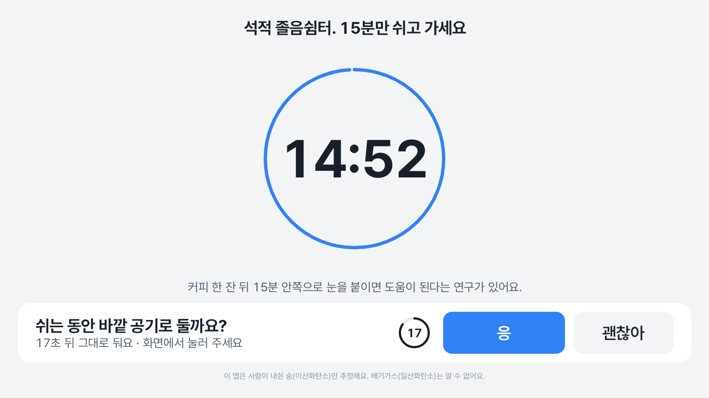 |
| **정차 화면** (좌석 지도의 자리를 누르면 그 자리 설정) | **자리 설정 시트** (여섯 가지, 바뀌는 것 한 줄씩) |
| 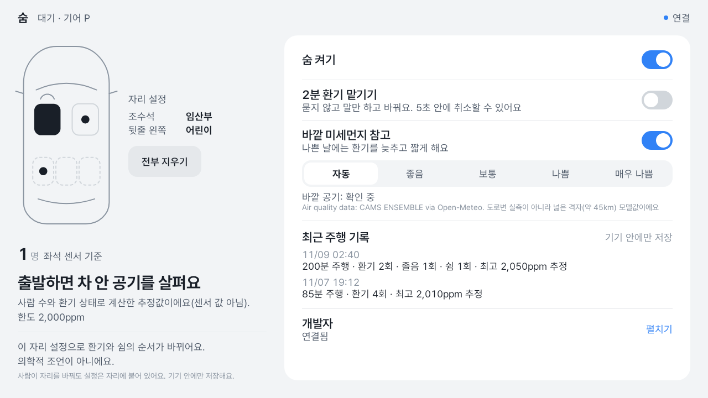 | 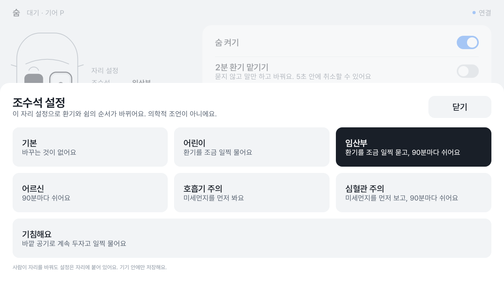 |
| **주행 홈의 살피는 것** (오른쪽 레일: 설정 한 줄과 앉은 시간) | **걷기 쉼 제안** (경유지만 넣고 공조는 건드리지 않음) |
| 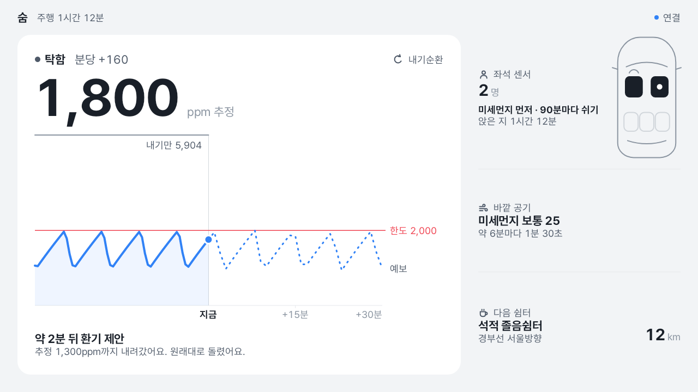 | 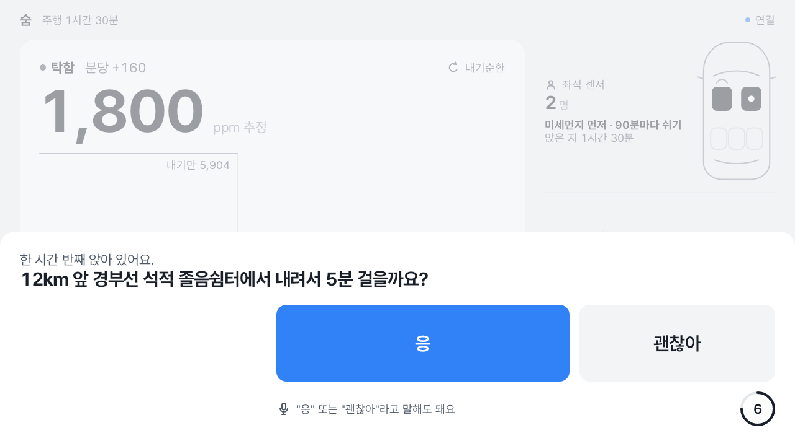 |

화면 1280×720, 헤드유닛 가로 기준. `docs/shots/` 에 31장이 있습니다.

- 낮 테마 22장 가운데 v0.7.2 까지의 17장: `01_주행중_홈`, `02_제안_환기`(4명 "바꿔 둘까요?"), `03_제안_졸음`, `04_실행중`, `05_쉼모드`, `06_도착카드`, `07_정차_설정`, `08_인원비교`, `09_제안_혼자`("2분만"), `10_예고_맡기기`, `11_도착카드_맡기기질문`, `12_자가진단`, `13_제안_동승자`, `14_조용_한도초과`("바깥 공기로" 버튼), `15_숨설계_홈`, `16_도착카드_세갈래`(자리별 값이 없는 주행: "차 전체" 한 줄), `19_쉼모드_화면닫기`
- v0.7.3 에서 더한 낮 테마 5장: `20_자리설정_시트`, `21_주행중_살피는것`, `22_제안_걷기쉼`, `23_도착카드_자리별`, `24_자가진단_프로필_Gleo`. `07_정차_설정` 은 자리 설정을 고른 상태로, `06_도착카드` 와 `11_도착카드_맡기기질문` 은 자리별 줄로 다시 찍었습니다
- 밤 테마 7장(이름 끝 `_밤`): `01_주행중_홈_밤`, `02_제안_환기_밤`, `04_실행중_밤`, `15_숨설계_홈_밤`, `16_도착카드_세갈래_밤`, `21_주행중_살피는것_밤`, `23_도착카드_자리별_밤`
- 넓은 창 2장: `17_넓은창_홈`(1700×900), `18_넓은창_제안`(1350×1000)

v0.7.3 의 화면은 v0.7.2 의 토큰과 규칙을 그대로 씁니다(색 직접 지정 없음, 한 화면에 글자 크기 넷까지). 좌석 지도에서 설정을 고른 자리는 가운데 작은 점으로 표시하고 이름은 옆 목록("조수석 임산부")에 적습니다. 자리 설정 시트의 고른 칸은 파랑이 아니라 본문 색 바탕입니다. 도착 카드의 자리별 줄은 숫자를 고정폭 굵은 글자로, 단위를 주석 크기 흐림 색으로 적고 색은 [확인] 버튼 하나에만 씁니다. 세 갈래 비교(내기만, 외기만)는 막대에서 한 줄로 내렸습니다.

v0.7.2 에서 글자와 색을 정돈했습니다. 화면에 나오는 색은 파랑 하나(#3182F6, 밤 #4C9AFF), 빨강 하나(#F04452, 밤 #FF6B76), 회색 단계뿐이고 호박색과 청록은 없앴습니다. 글자색은 세 단계(본문, 보조, 흐림)이고 색을 입힌 글자는 화면마다 한 군데 이하입니다(주행 홈은 곡선의 "한도 2,000", 정차 화면은 "펼치기"). 상태 한 단어("쾌적, 보통, 탁함, 한도")는 본문 색 굵은 글자 앞에 작은 점으로만 구별합니다. 굵기는 굵게와 보통 둘이고 중간 굵기는 버튼과 목록 행 제목에만 씁니다. 크기는 다섯 단계(96, 30, 22, 18, 14) 가운데 한 화면에 넷까지만 씁니다. 주 버튼은 파랑 바탕 흰 글자, 보조 버튼은 테두리 없는 회색 면입니다. 좌석 지도는 차가 준 자리별 값(ROW_1_LEFT 부터 ROW_2_RIGHT 까지)을 그대로 그리고, 자리별 값이 없을 때만 인원 수로 순서대로 채우며 "직접 입력"이라고 적습니다. 곡선은 출발 직후 "지금"을 왼쪽 4분의 1로 당겨 예보 구간을 넓게 씁니다. 제안 시트는 높이를 내용에 맞추고, 쉼 화면 버튼은 하는 일 그대로 "화면 닫기"입니다(쉼은 기어를 D 로 넣으면 끝납니다). 도착 카드의 "내기만", "외기만" 값은 가정에 따라 크게 흔들리는 값이라 "약 5,600"처럼 어림으로 적습니다. 창이 1280×720 보다 크면 글자와 여백을 같은 비율로 키웁니다(1.3배까지).

v0.7.1 에서 화면을 다시 그렸습니다. 판단과 문구는 그대로이고 그리는 층만 바꿨습니다. 낮(밝음)이 기본이고 시스템 야간 모드에서는 밤 테마로 바뀝니다. 색, 글자 크기 다섯 단계, 간격, 모서리는 `app/src/main/java/ai/kkaeugi/app/ui/theme/Tokens.kt` 한 곳에 있습니다. 주행 홈의 주인공은 숨 곡선 하나이고(반원 게이지는 없앴습니다), 오른쪽 좌석 지도는 탄 사람 수와 조수석 값으로 그립니다. 글꼴은 Pretendard(SIL OFL 1.1)이고 고지는 `THIRD_PARTY_NOTICES.md` 에 있습니다. JVM 에서 렌더링한 것이라(Paparazzi) 에뮬레이터 캡처와 조금 다를 수 있고, 자가 진단 화면의 값은 표본입니다. 다시 찍기: `./gradlew :app:testReleaseUnitTest -Pscreenshots=true`

> 설치 전에 이전 빌드를 지웁니다. `adb uninstall ai.kkaeugi.app` (서명 키가 바뀌어 `INSTALL_FAILED_UPDATE_INCOMPATIBLE` 이 날 수 있습니다.)

## 브라우저에서 체험

에뮬레이터가 없어도 `docs/sim/index.html` 을 브라우저로 열면 앱의 판단 흐름을 따라가 볼 수 있습니다. 파일 하나로 동작하고 외부로 아무것도 보내지 않습니다. `engine/` 의 엔진 소스를 그대로 Kotlin/JS 로 컴파일해 넣어서 앱과 같은 엔진이 판단합니다(차량 화면과 가상 차량 콘솔만 브라우저용으로 따로 만들었습니다). 오른쪽 콘솔에서 기어, 탑승 인원, 내기순환, 경고등을 바꾸면 차가 먼저 묻고, "응" 을 누르면 콘솔 값이 스스로 바뀌며 앱이 보낸 SDK 호출이 아래 로그에 남습니다. [자동 시연]은 약 2분 10초(132초)짜리 한 바퀴이고 [맡기기 시연]은 약 40초(41초)입니다. 화면은 한국어와 영어로 볼 수 있습니다. 이 페이지에는 음성 인식이 없어서 예고는 "싫으면 취소를 누르세요"로 나오고, 예고로 시작한 환기는 실행 중에도 [취소]가 붙습니다. 두 번 거절해 묻지 않는 중에 추정치가 한도를 넘으면 "바깥 공기로" 버튼이 뜹니다. 탭을 가리면 앱 화면이 안 보이는 것으로 엔진에 알립니다(그동안은 맡겼어도 예고하지 않고 묻습니다). 수치는 전부 추정값입니다. 다시 만들기: `websim/build.sh` (JDK 17, Node 18 이상). 이 스크립트가 스모크 테스트 32건을 컴파일한 엔진과 HTML 에 들어간 엔진에 한 번씩 돌립니다.

## APK

- 파일: `apk/안준영_숨_release.apk` (42,381,894바이트, 약 40.4MB, versionCode 13 / versionName 0.8.0, abi x86_64 + arm64-v8a. v0.7.2 보다 약 0.2MB 늘었습니다. v0.7.0 보다 약 3MB 늘어난 것은 Pretendard 글꼴 세 굵기입니다)
- 디버그 키로 서명한 release 빌드입니다. 별도 서명 없이 에뮬레이터와 테스트 기기에 바로 설치됩니다.
- 직접 빌드: 리눅스는 `export LC_ALL=C.UTF-8`, macOS 는 `export LC_ALL=en_US.UTF-8` 뒤 `./gradlew :app:assembleRelease` → `app/build/outputs/apk/release/`

## 숨 모델

탑승 인원과 환기 상태로 실내 CO2(ppm)를 추정하는 질량 수지 식입니다. 순수 Kotlin(`engine/.../CabinAirModel.kt`)이고 센서 값은 쓰지 않습니다.

```
dC/dt = (인원 × 1인 배출량 × 1e6 / 실내 부피) − ACH × (C − 바깥 농도)
ACH = 내기순환이면 누설분, 외기면 누설분 + 풍량 단계에 따른 외기 유입분, 창문이 열려 있으면 창문분을 더함
세션 시작 값 = 바깥 농도 + 200 (630ppm)
```

| 기본값 (WakeConfig) | 값 | 뜻 |
|---|---|---|
| co2PerPersonLph | 18 L/시간 | 앉아 있는 성인 한 명이 내쉬는 CO2 |
| cabinVolumeL | 3,000 L | 실내 공기 부피(약 3m³ 로 가정) |
| leakAch | 2 회/시간 | 내기순환일 때 새는 공기 교환 |
| freshAchMax | 60 회/시간 | 외기, 풍량 최대일 때 공기 교환. 1단 25 회/시간에서 최대 단까지 선형 |
| windowAch | 15 회/시간 | 창문 15% 열림 기준으로 더해지는 공기 교환 |
| outdoorPpm | 430 ppm | 바깥 공기 |
| co2LimitPpm | 2,000 ppm | 환기를 묻는 한도(위험 기준이 아님). 야간 장거리(하향등이 켜진 지 3분이 넘었고 트립 120분 이상)에는 0.8배인 1,600ppm |

계수의 출처와 문헌 범위는 `docs/EVIDENCE.md` 의 "F. 숨 모델" 절에 있습니다. 기본값으로 계산한 결과는 아래와 같고 엔진 단위 테스트로 고정했습니다.

- 내기순환에서 추정 2,000ppm 도달: 1명 약 20분, 2명 약 8분, 3명 약 5분, 4명 약 4분
- 야간 장거리 한도(1,600ppm) 도달: 1명 약 13분
- 외기, 4명, 풍량 1단의 정상 상태: 약 1,300ppm
- 1명, 외기로 바꾸고 2분 뒤(풍량 중간): 약 930ppm

### 인원에 따라 다르게 묻기

제안하는 순간 "2분 바깥 공기로 바꿨다가 내기순환으로 돌아가면 한도에 다시 닿기까지 몇 분인지"를 모델로 계산해 문장을 고릅니다. 문장은 전부 질문으로 끝나고, 괄호 안 추정 수치는 화면에만 쓰고 음성으로는 읽지 않습니다.

| 조건 | 문장 | 동의하면 |
|---|---|---|
| 재도달 예측 5분 이상 (기본값에서 1~2명) | "차 안 공기가 탁해진 것 같아요(추정 2,000ppm). 2분만 바깥 공기로 바꿀까요?" (2명이면 "2명이 타서 공기가 빨리 탁해져요(…)") | 2분 외기 뒤 원래대로. 연장 없음 |
| 재도달 예측 5분 미만 (기본값에서 3명 이상, 야간 장거리엔 2명도) | "4명이 타서 공기가 빨리 탁해져요(추정 2,000ppm). 바깥 공기로 바꿔 둘까요?" | "바깥 공기로 둘게요." 원복 없음 |
| 2명 이상이 "2분만"을 두 번 끝낸 뒤 | "여럿이 탈 땐 바깥 공기로 두는 게 좋아요. 계속 바깥 공기로 둘까요?" | "바깥 공기로 둘게요." 원복 없음 |
| 외기인데 풍량이 약해 한도를 넘음 (창문 닫힘) | "바깥 공기인데 바람이 약해요(추정 2,100ppm). 풍량을 올릴까요?" | 풍량 2단 올림, 원복 없음 |
| 내기순환 시간 상한 (창문 닫힘) | "내기순환으로 30분째예요. 2분만 바깥 공기로 바꿀까요?" | 2분 외기 뒤 원래대로 |

바깥 공기로 두자는 제안을 거절하면 다음 제안은 다시 "2분만"으로 묻습니다. 동의한 뒤 운전자가 직접 내기순환을 켜면 거절로 봅니다. 야간 장거리 때문에 평소보다 일찍 묻게 된 첫 제안에는 "오래 달려서 조금 일찍 물어요." 가 앞에 붙습니다.

한 시간 주행(내기순환으로 출발, 제안에 전부 동의, 풍량 3/8) 시뮬레이션 결과입니다. 엔진 테스트(`Round5Test`, `Round6Test`)가 같은 조건을 돌립니다.

| 탑승 | 제안 횟수 | 제안 시각(분:초) | 비고 |
|---|---|---|---|
| 1명 | 3회 | 20:10, 39:04, 57:58 | 전부 "2분만" 뒤 원복 |
| 2명 | 3회 | 8:06, 16:06, 24:06 | 세 번째가 "계속 바깥 공기로 둘까요?", 이후 외기 유지 |
| 3명 | 1회 | 5:05 | "바꿔 둘까요?", 이후 외기 유지 |
| 4명 | 1회 | 3:43 | "바꿔 둘까요?", 이후 외기 유지 |

네 경우 모두 최고 추정치는 2,004~2,034ppm 입니다.

### 맡기기: 처음엔 묻고, 맡기면 예고만

"2분만" 환기는 2분 뒤 원래대로 돌아오는 변경입니다. 이 제안에 물어서 동의하고 원복까지 끝낸 것이 세 번 연속이면(주행을 넘어 셉니다), 도착 카드에서 한 번 묻습니다.

- 질문: "오늘까지 환기 제안 3번에 모두 '응' 하셨어요. 다음부터 2분 환기는 말만 하고 바꿀까요?" 버튼은 [맡길게요] [계속 물어봐 주세요]. 정차 중에만 나옵니다.
- 맡긴 뒤 주행 중: "2분만 바깥 공기로 바꿀게요. 싫으면 '아니'라고 하세요." 읽기가 끝나고 5초 뒤에 바꿉니다. "응" 하면 기다리지 않고 바로 바꿉니다. 음성 인식기가 없거나 마이크 권한이 없으면 같은 자리를 "싫으면 취소를 누르세요."로 읽고 보여 줍니다.
- 예고는 숨 화면이 보일 때만 합니다. 내비 화면일 때는 맡겼어도 묻습니다(취소 버튼이 안 보이는데 바꾸지 않습니다).
- 예고 직전 차 자동 공조·도착 임박이면 실행하지 않습니다. 5초가 끝나 바꾸려는 순간 다시 봐서, 그 사이 차가 내외기를 스스로 조절하기 시작했거나, 도착 5분 전이 됐거나, 방향지시등이나 안전 경고등이 켜졌거나, 화면이 가려졌으면 바꾸지 않고 말없이 닫습니다. 취소로 세지 않고 5분 뒤에 다시 봅니다. 예고 문장을 읽지 못했으면(읽기가 문장 길이에 비해 너무 일찍 끝남) 바꾸지 않고 물어봅니다.
- 취소 경로: 5초 안에는 음성 "아니"와 화면 [취소]. 실행 중에는 실행 바 옆의 [취소](유지 2분 내내 보입니다)와 차의 내기순환 버튼. 실행 중에 취소하면 바로 원래대로 돌리고 "알겠어요. 원래대로 돌렸어요." 합니다.
- 5초 안에 취소하면 "알겠어요. 그대로 둘게요." 합니다. 어느 쪽이든 취소하면 그 주행은 다시 묻는 방식으로 돌아갑니다. 취소가 두 번 쌓이면 "맡기기를 껐어요. 다시 물어볼게요." 하고 맡기기가 꺼집니다. 맡긴 환기를 취소 없이 원복까지 끝내면 쌓인 취소 횟수는 지웁니다. 정차 화면 설정 "2분 환기 맡기기"로 언제든 켜고 끌 수 있습니다.
- 예고 중이나 맡긴 환기 중에 졸음 경고가 오면 예고는 닫고(환기는 조용히 원래대로 돌리고) 졸음 제안을 바로 냅니다.
- 맡겨도 항상 묻는 것: 되돌리지 않는 변경("바꿔 둘까요?", "계속 바깥 공기로 둘까요?", "풍량을 올릴까요?")과 졸음 개입.

동의를 없애는 게 아닙니다. 동의의 단위를 건별에서 범위가 정해진 맡김으로 바꾼 것이고, 예고와 취소는 남습니다.

한 시간 주행을 맡기기와 거절까지 넣어 다시 돌린 표입니다(`Round6Test`, `Round7Test`, 풍량 3/8, 문장은 4초에 읽고 5초 뒤 답함).

| 탑승과 조건 | 질문 | 예고 | 비고 |
|---|---|---|---|
| 1명, 전부 동의 | 3회 (20:10, 39:04, 57:58) | 0 | 위 표와 같음 |
| 1명, 맡기기 켬 | 0 | 3회 (20:10, 39:07, 58:04) | 환기 횟수와 바깥 공기 시간은 물을 때와 같음 |
| 1명, 전부 거절 | 2회 (20:10, 40:15) | 0 | 두 번째 거절 뒤 그 주행은 조용. 한도는 올리지 않음. 최고 추정 3,051ppm 이라 한도 2배 알림은 없음 |
| 2명, 전부 거절 | 2회 (8:06, 28:11) | 0 | 28:16 부터 조용. 33:16 에 "차 안 공기가 많이 탁해요(추정 4,500ppm). 화면에서 바깥 공기로 바꿀 수 있어요." 한 번 |
| 4명, 전부 거절 | 2회 (3:43, 23:48) | 0 | 23:53 부터 조용. 28:53 에 같은 알림 한 번(추정 7,900ppm). 홈에 "바깥 공기로" 버튼 |
| 1명, 화면 밖 2시간 무응답 | 6회 (20:10, 25:22, 45:34, 65:46, 85:58, 106:10) | 0 | 거절로 세지 않음. 두 번째부터는 20분 간격 |
| 2명, 맡기기 켬 | 1회 (24:12 "계속 바깥 공기로 둘까요?") | 2회 (8:06, 16:09) | 되돌리지 않는 변경이라 세 번째는 물음 |
| 4명, 맡기기 켬 | 1회 (3:43 "바꿔 둘까요?") | 0 | 맡겨도 물음 |

### 묻지 않는 때와 답하는 사람

- 두 번 연속 거절: 한 주행에서 환기 제안을 두 번 연속 거절하면 "이번 주행에서는 더 묻지 않을게요. 화면에만 표시할게요." 하고 환기를 묻지 않습니다. 홈에는 "이번 주행은 화면에만 표시해요"가 남습니다. 한도는 올리지 않습니다. 무응답은 거절로 세지 않습니다. 쉼터에서 쉬고 나면 풀립니다.
- 묻지 않는 중에 한도를 넘으면: 홈 문구가 "한도를 넘었어요(추정). 묻지 않는 중이에요"로 바뀌고 그 아래에 큰 "바깥 공기로" 버튼이 하나 뜹니다. 누르면 묻지 않고 2분 바꿨다가 원래대로 돌립니다(실행 중 [취소] 가능). 추정치가 한도의 2배(기본 4,000ppm)를 넘으면 조용해진 지 5분 뒤부터 주행당 한 번만 "차 안 공기가 많이 탁해요(추정 4,000ppm). 화면에서 바깥 공기로 바꿀 수 있어요."라고 알립니다.
- 화면 밖 무응답: 숨 화면이 안 보이는 동안 넘어간 제안은 거절로 세지 않고 5분 뒤에 다시 봅니다. 두 번 연속이면 거절과 같은 20분을 쉽니다. 화면이 다시 보이면 처음부터 셉니다.
- 도착 5분 전: 내비 목적지까지 5분 이하로 남으면 환기를 묻지 않습니다("도착 4분 전이라 묻지 않아요"). 내비가 10분 넘게 남은 시간을 다시 알려 주지 않으면 그 값은 쓰지 않습니다. 졸음 경고 때 목적지가 쉼터보다 가까우면 쉼터 대신 "졸음 경고가 떴어요. 4분 뒤 도착이에요. 찬 바람을 넣을까요?"라고 묻습니다.
- 차가 내외기를 자동 조절 중: 숨은 제어하지 않고 화면에만 표시합니다("차가 내외기를 자동 조절 중이에요").
- 하향등이 막 켜졌을 때: 켜진 지 3분이 안 됐으면 야간으로 보지 않고, 주행 중에 막 켜졌으면 환기 제안을 3분 미룹니다.
- 조수석에 사람이 있으면 답 버튼이 조수석 쪽으로 가고, 그 주행 첫 제안 끝에 "옆자리에서 눌러 주셔도 돼요."가 붙습니다.
- 정차 중에만 하는 것: 자가 진단, 탑승 인원 수동 입력, 맡기기 질문, 쉼터에서의 "쉬는 동안 바깥 공기로 둘까요?"(터치로 답. 쉼터에 들어오기 전 상태가 내기순환일 때만 묻고, 풍량은 올리지 않습니다).

알아 둘 점
- 전부 추정값입니다. 화면에도 "ppm 추정"이라고 표시합니다.
- 한 실험(Mathur, SAE 2020-01-1245)의 실측은 내기순환 30분 뒤 1명 약 1,600ppm, 4명 약 6,600ppm 입니다. 숨 모델은 이보다 1.2~1.5배 빨리 오르는 쪽이라 환기를 일찍 제안하는 쪽으로 치우칩니다.
- 모델은 차 속도를 쓰지 않습니다. 정차·정체 때 실제 누설은 더 작아서 모델이 낮게 볼 수 있습니다. 모델 계수가 실제보다 낮게 잡힌 경우를 대비해 내기순환 시간 상한(30분, 야간 장거리 20분)을 남겼고, 창문이 닫혀 있을 때만 겁니다. 기본값에서는 1명도 약 20분에 추정 한도에 닿으므로 보통은 추정 한도가 먼저 옵니다.
- 탑승 인원은 좌석별 점유 센서로 세고, 점유 값이 없는 좌석은 안전벨트 체결로 셉니다. 좌석 값이 아예 안 오면 정차 화면의 스테퍼(1~5명)로 직접 넣고, 넣지 않으면 1명으로 봅니다. 좌석은 5초마다 읽고 두 번 연속 같은 값일 때 반영합니다. 주행 중 운전석은 항상 1명으로 셉니다.
- 쉼 모드 중에는 추정을 멈추고(쉼 카드 아래에 "이 앱은 사람이 내쉰 숨(이산화탄소)만 추정해요. 배기가스(일산화탄소)는 알 수 없어요."를 늘 적어 둡니다), 쉼이 끝나면 문을 열고 내렸다고 보고 시작 값으로 되돌립니다.
- 이산화탄소 자체의 영향인지 환기 부족 전반의 영향인지는 연구마다 결과가 갈립니다. 숨은 추정값을 환기가 부족하다는 신호로만 씁니다.

핸들 보조 신호(실험, 기본 꺼짐): 개발자 설정에서 켰을 때만 봅니다. 6초 이상 무조작(변화폭 1도 안쪽, 직진 5도 안쪽) 뒤 1초 안에 8도 이상 꺾는 것을 1회로 세고, 10분 안에 3회면 "핸들 보정이 잦아졌어요."로 시작하는 제안을 냅니다(트립 30분 이후, 속도를 알면 60km/h 이상일 때만, 방향지시등이 켜져 있거나 직전 3초 안에 바뀌었으면 제외, 트립당 2회까지). EU 규정 2021/1341 이 졸음 지표의 예로 드는 패턴을 단순화한 것이고, 기준값은 자체 설정이라 검증 데이터가 없습니다. 그래서 기본값에서 뺐습니다. 도착 카드의 졸음 경고 횟수에도 넣지 않습니다.

## 실행 방법

### A. Pleos Connect 에뮬레이터 + 버추얼 콘솔 (정식 시연 경로)

0. 자가 진단부터 합니다. 아래 1~4를 마친 뒤 정차 화면(기어 P) 오른쪽 위 [자가 진단]을 누르면, 읽기 전용 호출만 순서대로 불러 약 49줄 보고서를 한 화면에 냅니다(성공 N / 실패 M). 연결 판정, Pleos 퍼미션 14개, 기어, 내기순환, 자동 내기순환, 풍량, 설정 온도, 창문 네 곳, 좌석 점유와 벨트 다섯 자리, 핸들 각도와 범위, 하향등, 와이퍼, 텔테일 등록, 트립 시간, 내비 초기화와 현재 위치, 목적지 남은 시간·거리, FusedLocation, TTS, STT, 마이크 권한, 알림 권한, 화면 밖 유지 상태입니다. 차 값은 바꾸지 않습니다. [복사]로 전체를 복사할 수 있고, 같은 줄이 Logcat 태그 `Kkaeugi.Diag` 와 파일 `diag_latest.txt`(앱 내부 저장소와 앱 전용 외부 저장소. `adb shell cat /sdcard/Android/data/ai.kkaeugi.app/files/diag_latest.txt`)에 남습니다. 화면을 누르지 않고 `--es what diag` 로도 돌립니다(아래 "에뮬레이터에서 확인하는 법"). 실패한 줄을 먼저 보고 아래 순서를 그에 맞춥니다.
1. Pleos Playground에서 받은 Pleos Connect 에뮬레이터를 실행합니다.
2. 이전 빌드를 지우고 APK를 설치합니다. `adb uninstall ai.kkaeugi.app` → `adb install apk/안준영_숨_release.apk`
3. 버추얼 콘솔 포트를 연결하고 브라우저로 엽니다. `adb forward tcp:8088 tcp:8088` → `http://127.0.0.1:8088`
4. 앱을 실행합니다. 홈 화면 위에 "Pleos 연결" 알약이 떠야 합니다. 알약 아래에 판정 근거가 표시됩니다. 안 뜨면 아래 "Pleos 연결이 안 뜰 때"를 봅니다.
5. 기어 P 상태에서 설정을 봅니다. 사용자 설정은 둘입니다. "숨 켜기"(기본 켜짐)와 "2분 환기 맡기기"(기본 꺼짐). 나머지는 접힌 "개발자" 묶음에 있습니다. 데모 속도(분→초), 증거 모드(주행 중 SDK 제어 호출 한 줄), 창문 방향 반전(닫힌 창문이 max 로 읽히는 차), 핸들 보조 신호(실험), 졸음 개입에 창문 포함(창문 방향 실측 뒤), 화면 밖에서도 유지(실험), 제어 검증, 데모 콘솔. 전부 기본 꺼짐이고 시연할 때는 데모 속도와 증거 모드만 켭니다. 데모 속도에서는 분이 초로 줄고 숨 모델은 60배속(1초 = 1분)으로 돕니다. 다만 제안에 답을 기다리는 동안과 제어 결과를 기다리는 동안은 실제 속도로 흐릅니다. 환기 20초, 졸음 개입 30초, 쉼 15초, 거절 뒤 쿨다운 20초, 내기순환 상한 30초(야간 20초).
6. 버추얼 콘솔에서 아래 순서대로 조작하면 개입 체인이 한 바퀴 돕니다. 시간은 데모 속도 기준(괄호 안이 실제 값)입니다.

| 순서 | 버추얼 콘솔 조작 | 앱에서 일어나는 일 |
|---|---|---|
| 0 | Safety: 주차브레이크 텔테일 OFF, Convenience: 하향등 OFF, Climate: 공조 AUTO 의 자동 내외기 OFF | 주차브레이크가 켜진 채 D 를 넣으면 세션이 바로 끝납니다. 차가 내외기를 자동 조절 중이면 숨은 묻지 않습니다 |
| 1 | 좌석 점유: 운전석만 점유 (기어 P) | 정차 화면 "탑승 인원 · 좌석 센서 기준 1명". 앱은 좌석을 5초마다 읽고 두 번 연속 같은 값일 때 반영하니 10초쯤 기다립니다. 점유 항목이 없는 좌석은 안전벨트 체결로 셉니다. 좌석 값이 아예 안 오면 같은 자리에 스테퍼(1~5)가 나옵니다 |
| 2 | Motion: 기어 D → Climate: 내기순환 ON | 큰 숫자(ppm 추정)와 숨 곡선이 올라가기 시작. 곡선 아래 "약 N분 뒤 환기 제안", 오른쪽 좌석 지도에 "1명" |
| 3 | 대기 약 20초 (20분) | "차 안 공기가 탁해진 것 같아요(추정 2,000ppm). 20초만 바깥 공기로 바꿀까요?" 실제 속도에서는 "2분만". 제안 카드("응" / "괜찮아")가 뜨고, 8초 카운트다운은 읽기가 끝난 뒤 시작합니다 |
| 4 | "응" 버튼 (음성은 Pleos STT 가 준비되고 마이크 권한이 있을 때만) | Climate 패널의 내기순환이 OFF(외기)로 바뀌고 풍량이 1단 올라감. 숫자와 곡선이 내려가고 "바깥 공기 들어오는 중 · 내려가는 중". 증거 모드면 맨 아래 한 줄 `SDK  setHvacRecirculation(false) → ok 0.3s` |
| 5 | 대기 20초 (2분) | 내기순환·풍량이 실행 전 값으로 돌아오고 "추정 N ppm까지 내려갔어요. 원래대로 돌렸어요." 그 사이 운전자가 콘솔에서 직접 바꾼 항목은 건드리지 않습니다 |
| 6 | 기어 P → 설정 "2분 환기 맡기기" ON → 기어 D, 내기순환 ON | 약 20초 뒤 질문 대신 예고 카드: "20초만 바깥 공기로 바꿀게요. 싫으면 '아니'라고 하세요." 큰 [취소] 버튼과 5초 카운트다운. 그대로 두면 5초 뒤 4~5와 같이 바뀌고 돌아옵니다. [취소]를 누르면 "알겠어요. 그대로 둘게요." 바뀐 뒤 콘솔에서 내기순환을 다시 켜도 취소로 셉니다 |
| 7 | 좌석 점유: 조수석과 뒷좌석 둘을 점유로 (4명) | 10초쯤 뒤 "탑승 4명". 같은 차인데 숫자와 곡선이 빨리 오르고, 맡겨 두었어도 예고가 아니라 질문이 나옵니다. "4명이 타서 공기가 빨리 탁해져요(추정 2,000ppm). 바깥 공기로 바꿔 둘까요? 옆자리에서 눌러 주셔도 돼요." 버튼이 조수석 쪽에 놓입니다 |
| 8 | "응" | "바깥 공기로 둘게요." 원복 없이 외기 유지. 내기순환을 다시 켜기 전까지 환기 제안이 없습니다 |
| 9 | Safety: 텔테일 DRIVER_ATTENTION ON | "졸음 경고가 떴어요. 찬 바람 넣고, 12km 앞 경부선 석적 졸음쉼터 경유까지 할까요?" (쉼터 이름과 거리는 위치에 따라 다릅니다. 전방 같은 방향에 쉼터가 없으면 "졸음 경고가 떴어요. 찬 바람을 넣을까요?", 목적지가 쉼터보다 가까우면 "졸음 경고가 떴어요. N분 뒤 도착이에요. 찬 바람을 넣을까요?") |
| 10 | "응" | Climate 온도 2도 내림, 외기, 내비 경로 첫 경유지(WaypointIndex.FIRST)에 쉼터 추가. 창문은 열지 않습니다(기본 설정). 30초(2분) 뒤 공조만 원복, 경유지는 유지 |
| 11 | (에뮬레이터 GPS 를 쉼터 300m 안으로) Climate: 내기순환 ON → Motion: 기어 P | 쉼 모드: "석적 졸음쉼터. 15분만 쉬고 가세요"와 큰 카운트다운(데모 15초). 내기순환이면 아래에 "쉬는 동안 바깥 공기로 둘까요?"(터치로 답, 20초 뒤 그대로 둠). 세션은 끝나지 않고 추정은 멈춥니다 |
| 12 | Motion: 기어 D | "N분 쉬셨어요. 다음 쉼터에서 더 쉬어도 좋아요" 하고 홈으로 복귀. 쉬는 동안 바꿔 둔 바깥 공기는 원래대로. 추정치는 시작 값부터 다시 셉니다 |
| 13 | 제안에서 "괜찮아" 두 번 | 첫 번째는 "알겠어요. 20초 뒤에 다시 볼게요."(실제 20분). 두 번째는 "이번 주행에서는 더 묻지 않을게요. 화면에만 표시할게요." |
| 14 | 내비에 목적지를 넣고 도착 5분 전까지 진행 (내기순환 ON) | 곡선 아래 "도착 N분 전이라 묻지 않아요". 환기 제안이 나오지 않습니다 |
| 15 | Motion: 기어 P (쉼터 밖) | 도착 카드: 주행, 환기, 바깥 공기, 졸음 경고, 쉼터, 거절 횟수와 "최고 N ppm 추정 · 한도 위 N분(추정) · N명 탑승". 이번 세션 수치만. "2분만"에 세 번 연속 동의했으면 카드 안에 맡기기 질문이 나옵니다 |

2명이 탈 때는 "2분만" 환기를 두 번 끝낸 뒤 세 번째 제안이 "여럿이 탈 땐 바깥 공기로 두는 게 좋아요. 계속 바깥 공기로 둘까요?" 로 바뀝니다. 하향등이 켜진 지 3분이 넘고 트립이 장거리 기준(120분)을 넘으면 한도가 1,600ppm 으로 낮아집니다.

개발자 설정으로 켜는 것(기본 꺼짐)
- 졸음 개입에 창문 포함: 켜면 졸음 문장이 "졸음 경고가 떴어요. 찬 바람과 창문 조금, … 경유까지 할까요?"가 되고 운전석 창문을 15% 엽니다. 와이퍼 ON 이면 "비가 와서 창문은 두고…"로 창문을 뺍니다. 에뮬레이터에서 창문 방향(닫힘이 min 인지 max 인지)을 실측한 뒤에 켭니다.
- 핸들 보조 신호(실험): 켜고 핸들 각도를 6초 이상 그대로 두었다가 1초 안에 8도 넘게 꺾는 것을 10분 안에 세 번 넣으면(트립 30분 이후) "핸들 보정이 잦아졌어요. 찬 바람 넣고, … 경유까지 할까요?" 가 나옵니다. 졸음이라고 말하지 않고, 졸음 경고 횟수에도 넣지 않습니다.

쉼터 후보: 앱이 30초마다(또는 1km 이상 이동 시) 현재 위치·진행 방향 기준으로 상·하행을 구분해 3~80km 안 최근접 쉼터 한 곳을 엔진에 보냅니다. 전방에 없으면 경유지 액션은 빠집니다. 경유지로 넣은 쉼터를 1km 안까지 갔다가 다시 1.5km 밖으로 멀어지면 removeWaypoint 로 빼고 요약에 "지나침"으로 셉니다. 쉼터 이름이 "쉼터"나 "휴게소"로 끝나지 않으면 " 졸음쉼터"를 붙여 부릅니다. 모의 모드의 기준 위치는 경부선 칠곡 부근(서울방향, 전방 12km 석적졸음쉼터)이고, 에뮬레이터 GPS 가 한국 밖이면 후보가 없으니 시연 전에 경부선 위 좌표로 맞춥니다.

#### Pleos 연결이 안 뜰 때

- 먼저 [자가 진단]을 누릅니다. 퍼미션 14개와 호출별 성공·실패가 한 화면에 나오고, Logcat 태그 `Kkaeugi` 에도 "차량: 등록 실패 …" 줄로 등록 실패가 찍힙니다. `PRIVATE_CAR_SAFETY`(텔테일 전용)가 거부되면 졸음 경고를 받을 수 없어 졸음 쪽 제안은 나오지 않습니다(개발자 설정의 핸들 보조 신호를 켠 경우만 예외). 공기 쪽은 영향이 없습니다. `CAR_SEATS` 가 거부되면 정차 화면 스테퍼로 탑승 인원을 직접 넣고, 넣지 않으면 1명으로 보고 약 20분에 묻습니다.
- 연결 판정: `Vehicle.initialize()` 는 예외를 던지지 않습니다. 앱은 초기화 1.5초 뒤 기어 상태를 조회하고(4초 타임아웃) 성공해야 "Pleos 연결"로 표시합니다. 실패하면 "모의 모드"로 바뀌고 데모 콘솔이 자동으로 열립니다. 알약 아래에 판정 근거가 적힙니다. 최대 5.5초는 기다립니다.
- 에뮬레이터 이미지 버전: Pleos Playground 의 최신 에뮬레이터 이미지와 Vehicle SDK 2.3.2 / NaviHelper 3.0.5 조합을 기준으로 만들었습니다. 오래된 이미지는 버추얼 콘솔(8088)이 없거나 텔테일 항목이 다릅니다.
- 이 저장소의 동작은 아직 Pleos 에뮬레이터에서 실측하지 않았습니다(실측 0건). 자가 진단과 아래 제어 검증은 실측할 때 쓰는 도구입니다.

증거 모드: 기어 P 의 개발자 묶음에서 켭니다. 켜면 주행 중 화면 맨 아래에 마지막 제어 호출(set*, addWaypoint, removeWaypoint) 한 줄이 보입니다. 성공은 `SDK  setHvacRecirculation(false) → ok 0.3s`, 실패는 `SDK  setHvacRecirculation(false) → 실패 DRIVING_RESTRICTED` 꼴이고, 모의 모드에서는 호출 이름 앞에 "모의 "가 붙습니다. 읽기 호출은 찍지 않습니다. 주행 중 디버그 UI(자가 진단, 제어 검증, 로그)는 숨겨집니다. 증거 모드가 켜져 있으면 Pleos 연결 상태에서도 주행 중 오른쪽 "데모" 탭 드로어("쉼터 도착" 등)가 보입니다.

검증은 두 단계입니다. 자가 진단은 읽기만 하고 한 번에 끝납니다. 제어 검증(기어 P, 개발자 묶음 안)은 차 값을 바꾸는 호출을 하나씩 누릅니다. 버튼 순서: 내기순환 읽기, 외기로 전환, 풍량 +1, 온도 -2, 창문 15%, 경유지 추가, 경유지 삭제, 트립시간 raw 읽기, 단위: 초로 확정, 단위: 분으로 확정, 탑승 인원 읽기(좌석별 점유와 벨트, 어느 출처로 셌는지), 핸들 각도 읽기, 핸들 각도 범위 읽기, 창문 위치 읽기(raw/min/max), 검증 원복(검증 버튼으로 바꾼 값을 처음 값으로 되돌림). 결과는 화면과 Logcat(`Kkaeugi.Verify`)에 남습니다.

로그 태그: `Kkaeugi.Diag`(자가 진단), `Kkaeugi.Verify`(제어 검증), `Kkaeugi.Pleos`(SDK 호출 래퍼 PleosCalls), `Kkaeugi.Vehicle`(신호 바인딩, 탑승 인원, 트립시간 단위 판정), `Kkaeugi.Actuator`(제어·원복), `Kkaeugi.Nav`(목적지 남은 시간 단위 판정 포함), `Kkaeugi.RestStop`, `Kkaeugi.TTS`, `Kkaeugi.STT`, `Kkaeugi.TripLog`, `Kkaeugi`(화면의 신호·이벤트 로그와 같은 줄: 퍼미션 등록 실패, 연결 판정, 엔진 이벤트).

### 에뮬레이터에서 확인하는 법 (Virtual Console 과 adb)

화면을 누르지 않고 터미널에서 값을 바꾸고 결과를 볼 수 있습니다. 앱 화면은 띄워 둔 채로 합니다(수신기는 화면이 살아 있을 때만 엔진에 닿습니다).

1. Virtual Console 을 엽니다. `adb forward tcp:8088 tcp:8088` 뒤 브라우저에서 http://127.0.0.1:8088/ 을 엽니다. 여기서 좌석(Seat: 자리별 점유와 벨트), 공조(HVAC: 내기순환, 풍량, 전원), 와이퍼, 기어, 등화 값을 바꿉니다. 에뮬레이터 실측(2026-11-11): 좌석 다섯 칸이 읽히고 기본값은 운전석 없음, 나머지 있음입니다. 내기순환 영역은 0x75, 풍량 영역은 0x5, 창문 범위는 0~10 이었습니다.
2. 자리 설정과 앉은 시간: Virtual Console 에서 조수석과 뒷줄 점유를 켜고 끄면 정차 화면의 좌석 지도가 따라 바뀝니다. 지도의 자리를 눌러 설정을 고르고 기어를 D 로 바꾸면 주행 홈 오른쪽에 "살피는 것" 한 줄과 "앉은 지 N분"이 나옵니다. 기어 P 로 5분 넘게 두었다가 D 로 바꾸면 앉은 시간이 0 부터 다시 셉니다(문 열림 경고등이 오는 차에서는 그동안 문이 열렸을 때만).
3. Gleo 함수 부르기(Gleo AI 가 보내는 것과 같은 경로: 함수 이름이 action 인 방송). 답은 방송 `ai.pleos.playground.intent.action.APP_ACTION_RESPONSE` 로 나가고 같은 내용이 Logcat `Kkaeugi.Gleo` 에 남습니다.

```
adb logcat -s Kkaeugi.Gleo Kkaeugi.Verify &
adb shell am broadcast -n ai.kkaeugi.app/.gleo.GleoReceiver -a CHECK_CABIN_STATUS --es topic air
adb shell am broadcast -n ai.kkaeugi.app/.gleo.GleoReceiver -a CHECK_CABIN_STATUS --es topic sitting
adb shell am broadcast -n ai.kkaeugi.app/.gleo.GleoReceiver -a VENTILATE_CABIN
adb shell am broadcast -n ai.kkaeugi.app/.gleo.GleoReceiver -a ADD_REST_STOP
adb shell am broadcast -n ai.kkaeugi.app/.gleo.GleoReceiver -a CHECK_CABIN_STATUS --es ACTION_PARAM '{"topic":"sitting"}'
```

   `VENTILATE_CABIN` 은 주행 중(기어 D) 내기순환일 때만 바깥 공기로 바꾸고 2분 뒤 되돌립니다. 차가 내외기를 자동으로 조절하는 중이면 건드리지 않고 그렇게 답합니다. `ADD_REST_STOP` 은 주행 방향을 알고 앞에 쉼터가 있을 때만 경유지를 넣습니다.

4. 제어 검증을 한 줄로(차 값을 바꿨다가 되돌립니다. 기어 P 에서, 숨 화면을 앞에 띄워 둔 채 하기를 권합니다). `what` 은 `fresh`(내외기 전환), `fan`(풍량 한 단), `window`(운전석 창문 10%), `all`(셋 다) 가운데 하나입니다.

```
adb shell am broadcast -n ai.kkaeugi.app/.gleo.VerifyReceiver -a ai.kkaeugi.app.VERIFY --es what all
adb shell am broadcast -n ai.kkaeugi.app/.gleo.VerifyReceiver -a ai.kkaeugi.app.VERIFY --es what result
adb shell cat /sdcard/Android/data/ai.kkaeugi.app/files/verify_latest.txt
```

   항목마다 `읽기 → 명령 → 확인(0.5초 간격, 최대 3초) → 2초 유지 → 원복 → 확인(최대 3초, 안 되면 원복을 한 번 다시 보냄)` 순서로 돕니다. 결과 한 줄의 모양: `[내외기] 전 내기 → 명령 외기 → 읽음 외기(0.5초) → 원복 내기 → 읽음 내기(0.5초) : 성공`. 괄호 안은 그 값을 볼 때까지 기다린 시간이고, 실패하면 끝에 사유가 붙습니다(`쓰기 실패: DRIVING_RESTRICTED` 등). 맨 위에 `[처음 상태]`, 맨 아래에 `[끝 상태] … : 처음과 같음`(또는 `처음과 다름`) 줄이 붙습니다. 공조 전원이 꺼져 있으면 내외기와 풍량을 보기 전에 전원을 켜고, 다 끝난 뒤 다시 끕니다(`[공조 전원]` 줄). 항목 하나의 명령이 다른 값을 건드린 경우(전원이 켜지면서 내외기가 바뀌는 차)는 `[마무리]` 줄에서 처음 값으로 한 번 더 돌립니다. 전원을 읽을 수 없는 차에서는 전원을 건드리지 않고 그 사실을 적습니다.

   결과가 남는 곳은 셋입니다. (가) 방송 결과: 8.5초 안에 끝나면 adb 가 `Broadcast completed: result=1, data="…"` 로 보고서 전체를 바로 찍습니다. `all` 은 10초쯤 걸려 `result=2` 와 그때까지의 줄만 나오니, 끝난 뒤 `--es what result` 로 다시 읽습니다. (나) Logcat `Kkaeugi.Verify` 에 한 줄씩. (다) 파일 `verify_latest.txt`: 앱 내부 저장소와 앱 전용 외부 저장소 두 곳. release 빌드라 `run-as` 로는 내부 파일을 읽을 수 없어서(`run-as: package not debuggable`) 외부에도 씁니다. 외부 경로는 보통 위의 `/sdcard/Android/data/…` 이지만, 운전자가 사용자 10 인 에뮬레이터에서는 `/storage/emulated/10/Android/data/ai.kkaeugi.app/files/` 일 수 있습니다. 앱이 실제 경로를 결과 마지막 줄과 Logcat 에 적으니 그 경로를 쓰고, 그래도 읽히지 않으면 `--es what result` 를 씁니다.

   검증은 방송 수신기가 아니라 앱 프로세스에서 돌고, 도는 동안 작은 서비스가 프로세스를 붙듭니다. 화면을 닫아도 원복까지 끝냅니다. 숨이 환기를 묻거나 실행하는 중이면 시작하지 않습니다. 이 수신기는 차 값을 바꾸기 때문에 `android.permission.DUMP` 를 가진 쪽(adb shell, 시스템)만 보낼 수 있게 막아 두었습니다. Pleos 가 없는 기기에서는 모의 차량으로 같은 순서를 돕니다.

5. 자가 진단과 상태 덤프도 adb 로 돌립니다(둘 다 읽기 전용).

```
adb shell am broadcast -n ai.kkaeugi.app/.gleo.VerifyReceiver -a ai.kkaeugi.app.VERIFY --es what diag
adb shell am broadcast -n ai.kkaeugi.app/.gleo.VerifyReceiver -a ai.kkaeugi.app.VERIFY --es what diagresult
adb shell cat /sdcard/Android/data/ai.kkaeugi.app/files/diag_latest.txt
adb shell am broadcast -n ai.kkaeugi.app/.gleo.VerifyReceiver -a ai.kkaeugi.app.VERIFY --es what state
adb shell am broadcast -n ai.kkaeugi.app/.gleo.VerifyReceiver -a ai.kkaeugi.app.VERIFY --es what help
```

   `diag` 는 정차 화면의 [자가 진단]과 같은 것을 돌립니다(기어 P 에서만). 끝에 두 절이 붙습니다. "프로필과 앉은 시간"(자리 설정, 자리별 값, 문 신호를 받았는지, 살피는 것, 앉은 시간)과 "Gleo"(schema.json 의 함수 수, 수신기 등록, 마지막 호출과 답). 8.5초 안에 끝나지 않으면 `diagresult` 로 다시 읽습니다. `state` 는 지금 읽은 값을 한 번에 적습니다: 기어, 내기순환, 자동 내기순환, 공조 전원, 풍량, 설정 온도, 창문 네 곳, 좌석 다섯 자리, 띠 다섯 자리, 와이퍼, 하향등, 조향각, 내비 남은 시간. 그 아래에 앱이 지금 쓰고 있는 값(주행 상태, 인원과 그 출처, 자리, 앱이 본 내외기와 풍량, CO2 추정)이 붙어서, 차에서 읽은 값과 앱이 쓰는 값이 다른지 바로 보입니다. 주행 중에도 됩니다. 결과는 방송 결과, Logcat `Kkaeugi.Verify`, `state_latest.txt` 에 남습니다. 화면이 떠 있지 않으면 `result`, `diagresult`, `help` 만 답합니다. 그때는 `adb shell am start -n ai.kkaeugi.app/.MainActivity` 로 먼저 엽니다.

Gleo Interface 에 대해 문서에서 확인한 것(document.pleos.ai, 2026-11-12): 앱은 `assets/schema.json` 에 함수를 적고(셋까지), Gleo AI 는 함수 이름을 action 으로, 파라미터를 문자열 extra `ACTION_PARAM`(JSON)으로 넣어 방송(component "service")이나 액티비티 시작(component "activity")으로 보냅니다. 앱은 `functionName`, `status`(success, asking, fail), `message`(짧은 영어 문장), `data`(선택)를 JSON 으로 돌려주고, Gleo 는 7초 안에 답이 없으면 그 액션을 버립니다. 스키마는 Gleo 쪽 검토를 거쳐 승인된 뒤에 쓸 수 있습니다. 그래서 지금 음성으로 불리는지는 확인하지 못했고, 위 adb 명령으로 같은 경로만 확인합니다. 함수 상한이 셋이라 "공기 어때"와 "얼마나 앉아 있었어"는 `CHECK_CABIN_STATUS` 하나에 `topic` 으로 묶었습니다. 답의 `message` 는 문서대로 영어이고, 한국어 한 문장은 `data` 의 `koreanSentence` 에 함께 싣습니다.

### B. 일반 Android 기기 / 일반 에뮬레이터 (Pleos 없이)

Pleos Vehicle SDK 서비스가 없는 기기에서는 연결 판정이 실패해 "모의 모드"가 되고 데모 콘솔이 자동으로 열립니다(주행 중에는 오른쪽 "데모" 탭 드로어). 기어, 내기순환, 탑승 인원, 풍량(3/8, 6/8), 창문(0%/15%), 맡기기 켜기·끄기, 조수석, 차 자동 공조, 도착 예정, 핸들 급보정 3회, 쉼터 근접, 경고등(DRIVER_ATTENTION 등), 하향등, 와이퍼, 트립시간을 직접 올리고 내릴 수 있습니다. 모의 차량은 환기하면 화면의 내외기·풍량 상태도 실제로 바뀝니다.

기어 P 에서 "시연 시나리오(약 2분)" 버튼을 누르면 혼자 돕니다(아무도 누르지 않으면 약 1분 57초, 제안마다 바로 누르면 약 1분 42초. 테스트가 잰 값). v0.7.3 의 가족 시나리오입니다. 순서: 기어 P, 자리 설정(조수석 임산부, 뒷줄 왼쪽 어린이), 혼자, 밖 미세먼지 나쁨 → D → 내기순환 ON → 약 20초 뒤 "밖 미세먼지가 나쁨이라 10초만 짧게 바꿀까요?"(빈자리의 설정은 쓰지 않아 한도 2,000 에서 묻습니다) → 응 → 원복 → 밖 공기 좋음, 조수석과 뒷줄 왼쪽과 뒷줄 오른쪽에 탑승(4명) → 한도의 90%에서 "어린이 자리가 있어 조금 일찍 물어요. 4명이 타서 공기가 빨리 탁해져요(…). 바깥 공기로 바꿔 둘까요? 옆자리에서 눌러 주셔도 돼요." → 응 → 외기 유지 → 트립 +90분(운전석에 앉은 지 90분) → "한 시간 반째 앉아 있어요. 12km 앞 경부선 석적 졸음쉼터에서 내려서 5분 걸을까요?" → 응 → 쉼터만 경유지에 → 쉼터 300m → P → 걷기 쉼(데모 속도라 5초) → D(앉은 시간은 0 부터, 걷기 쉼 1회) → 목적지 4분 → P → 자리별 도착 카드. 졸음 경고 장면이 있는 v0.7.2 시나리오(`DemoScenario.steps`)는 회귀 테스트가 그대로 돌리고, 앱에서는 데모 콘솔의 "DRIVER_ATTENTION ON" 칩으로 볼 수 있습니다. 데모 콘솔에는 자리 칩(가족 4명 자리, 혼자 자리, 자리별 값 없음), 문 열림과 닫힘, "트립시간 +90분(걷기 쉼)"이 더 있습니다.

## 테스트 환경과 필요한 설정

- Android API 28 이상, 가로 화면(landscape) 고정
- JDK 17, Gradle 8.x, Kotlin, Jetpack Compose
- Pleos Playground Maven 저장소: `https://nexus-playground.pleos.ai/repository/maven-releases/` (settings.gradle.kts에 등록됨)
- Pleos Connect 에뮬레이터 v2.1.0(`Pleos_Connect_v2.1.0`)과 버추얼 콘솔(`adb forward tcp:8088 tcp:8088`, `http://127.0.0.1:8088`)
- 화면 규격: 1280×720 가로(헤드유닛 기준). 더 큰 창에서는 글자와 여백을 같은 비율로 키웁니다(1.3배까지)
- 네트워크: TTS/STT HYBRID 모드용 인터넷. 그 외 서버 통신 없음. 외부 LLM 사용 안 함.
- 음성으로 답하려면 Pleos STT 서비스와 마이크 권한(RECORD_AUDIO)이 필요합니다. 둘 중 하나라도 없으면 버튼으로만 답합니다.
- 매니페스트: 액티비티에 `distractionOptimized` 메타데이터, `android.hardware.type.automotive` 와 `android.hardware.microphone` 은 required=false(폰·일반 AVD 에도 설치되게).
- 설정은 기기에 저장됩니다. 맡기기 상태(맡겼는지, 연속 동의 횟수, 취소 횟수)도 기기 안에만 저장합니다.

단위 테스트 759개: 엔진 377개(상태기계 67, 숨 모델 연동 34, 5차 동작 38, 6차 동작 56, 7차 동작 29, 숨 모델 식 15, 숨 설계 모델 32, 숨 설계 연동 27, 자리 부품 28, 자리 연동 39) `./gradlew :engine:test`, 앱 382개(자리 화면 글과 표본 17, Gleo 로직과 스키마 12, 시연 시나리오 10, adb 제어 검증 7, HVAC 영역 38, v0.6 순수 로직 30, 음성 판정 25, 제어·원복 23, 이벤트 처리 23, 쉼터 매칭 19, 숨 설계 문구와 표본 18, 탑승 인원·핸들·창문 입력 17, v0.6.1 순수 로직 15, 홈 문구 14, 바깥 미세먼지 소스 13, v0.7.2 화면 글과 배치 13, 좌석 자리별 값 8, 그 외 47) `./gradlew :app:testReleaseUnitTest`. v0.7.2 까지의 611개는 그대로 통과합니다. 자리 연동(v0.7.3)에는 프로필이 전부 기본이고 걷기 쉼이 꺼져 있으면 v0.7.2 와 이벤트가 같다는 비교, 탄 자리의 프로필만 쓰는지, 프로필 조합과 등급과 밤낮을 모두 돌려 한도가 기본 한도를 넘지 않는지, 일어섬 규칙(자리가 2분 이상 빔, 기어 P 5분, 문 신호가 있는 차와 없는 차), 걷기 쉼과 졸음 제안의 합치기, 자리별 누적이 들어 있습니다. 숨 설계 연동(v0.7.0)에는 바깥 미세먼지 값이 없으면 v0.6.2 와 이벤트가 같다는 비교, 한도를 정하는 순서(기본 → 야간 장거리 0.8배 → 나쁨 이상이면 그 여유를 없앰), 등급별 문장과 길이, 세 갈래 비교, 여정 예보, 낮잠 타이머가 들어 있습니다. 6차 동작에는 맡기기, 두 번 거절 뒤 조용, 도착 임박, 동승자, 차의 자동 내외기, 하향등 3분, 쉼 진입 질문, 한 시간 표가 들어 있습니다. 7차 동작(v0.6.1)에는 화면 밖에서는 예고하지 않기, 예고 직전 다시 보기, 실행 중 취소, 예고와 졸음 경고의 겹침, 조용 모드의 한도 초과 알림과 직접 환기, 화면 밖 무응답, 낡은 도착 예정이 들어 있습니다. 브라우저 시뮬레이터 스모크 테스트 32개는 `websim/` 에 있습니다. 테스트 이름이 한글이라 먼저 리눅스는 `export LC_ALL=C.UTF-8`, macOS 는 `export LC_ALL=en_US.UTF-8` 을 해 둡니다.

화면 스크린샷: `./gradlew :app:testReleaseUnitTest -Pscreenshots=true` 가 `app/src/shots/java/ai/kkaeugi/app/ui/ScreenshotTest.kt` 를 돌려 `docs/shots/` 31장(낮 22, 밤 7, 넓은 창 2)을 다시 만듭니다. 문서에 싣지 않는 점검용 장(개발자 영역, 직접 입력, 좁은 창 등)은 `app/build/check-shots/` 에 따로 나옵니다(Paparazzi, layoutlib 내려받음. 이때 앱 테스트가 1개 늘어 352개). 플래그 없이는 이 테스트가 빠져 일반 테스트 시간에 영향이 없습니다.

## 빌드 재현

소스에서 APK 를 다시 만들 때 필요한 것과 순서입니다. `apk/` 의 파일과 같은 설정(release, 디버그 키 서명, minify 없음)으로 나옵니다.

- JDK 17 (Temurin 등 아무 배포판)
- Android SDK: Platform 34 (`platforms;android-34`), Build Tools 34.0.0 (`build-tools;34.0.0`), platform-tools. Android Studio 로 설치했으면 `local.properties` 의 `sdk.dir` 또는 환경 변수 `ANDROID_HOME` 으로 위치를 알려 줍니다.
- Gradle 8.x: 저장소에 든 wrapper(`./gradlew`, Gradle 8.14.3)를 쓰면 따로 설치하지 않아도 됩니다. Android Gradle Plugin 8.7.3, Kotlin 2.0.21.
- 네트워크: 첫 빌드 때 Pleos Playground Maven(`https://nexus-playground.pleos.ai/repository/maven-releases/`)에서 Vehicle, NaviHelper, TextToSpeech, SpeechToText, FusedLocation SDK 를 내려받습니다. 현재 이 저장소는 인증 없이 읽을 수 있어 자격 증명 설정이 없습니다. Google Maven, Maven Central 도 함께 씁니다. 오프라인에서는 첫 빌드가 되지 않습니다.

```
export LC_ALL=C.UTF-8   # 테스트 이름이 한글이라 필요합니다. macOS 는 en_US.UTF-8
./gradlew :engine:test :app:testReleaseUnitTest :app:assembleRelease
# 결과: app/build/outputs/apk/release/app-release.apk
```

같은 명령을 GitHub Actions(`.github/workflows/build.yml`)가 push 마다 ubuntu-latest 에서 돌리고, 만들어진 APK 를 워크플로 artifact 로 올립니다. 로컬에서 만든 APK 를 제출용으로 쓸 때는 `apk/안준영_숨_release.apk` 이름으로 바꿔 넣습니다.

빌드 전에 공개 저장소에 개인정보가 섞이지 않았는지 `tools/privacy_scan.sh` 로 확인할 수 있습니다(전화번호, 이메일, 주민번호 패턴을 추적 파일 전체에서 찾아 0건이면 exit 0). `tools/export_public.sh` 는 `.gitignore` 를 적용한 파일만 새 디렉터리에 복사해 단일 커밋 저장소로 만든 뒤 같은 스캔을 돌립니다.

## 저장소 구성

```
kkaeugi/
├── apk/                      제출용 APK (안준영_숨_release.apk)
├── engine/                   순수 Kotlin 상태기계 (Android 의존성 없음)
│   └── src/main/kotlin/ai/kkaeugi/engine/
│       Contract.kt     엔진↔앱 계약 v5 (신호, 행동, 이벤트, 요약, 설정. 숨 모델, 맡기기, 조용 모드, 도착 예정, 동승자, 차의 자동 내외기, 숨 설계의 바깥 미세먼지와 설계 결과 포함)
│       WakeEngine.kt   트리거 판정(숨 모델 한도/시간 상한/졸음 경고/핸들 보조), 제안 변형 선택, 제안 또는 예고·동의·실행·원복·쿨다운·쉼 모드 상태기계
│                       (IDLE → AWAITING_ANSWER → EXECUTING → RUNNING → REVERTING, 쉼터에서 쉼 모드)
│       CabinAirModel.kt   숨 모델: 탑승 인원·내외기·풍량·창문으로 실내 CO2 추정(질량 수지, 해석해 전진)
│       CabinPmModel.kt    실내 PM2.5 추정(1차 완화 모델, 노출량 적분), VentPlanner.kt 환기 설계기(등급, 필요한 길이, 듀티 사이클, 여정 예보)
│       Counterfactual.kt  세 갈래 그림자 계산(내내 내기만, 내내 외기만)과 지나온 곡선, AlertnessWeight.kt 졸리기 쉬운 시간대 가중
│       Signals.kt      기어·브레이크·방향지시등·와이퍼·하향등·텔테일·내비·위치(속도) 신호, SpeechGate.kt 발화 게이트, TripSession.kt 트립 집계
│   └── src/test/...    WakeEngineTest.kt, AirEngineTest.kt, Round5Test.kt, Round6Test.kt, Round7Test.kt, CabinAirModelTest.kt, BreathModelTest.kt, BreathEngineTest.kt (298개)
├── app/src/main/java/ai/kkaeugi/app/
│   WakeViewModel.kt    SignalBus → WakeEngine → 이벤트 처리(TTS, 제안 카드, 예고 카드, 실행 바, 쉼 모드, 도착 카드), STT 분기, 맡기기 저장
│   EventLogic.kt, DemoText.kt   이벤트 처리 규칙, 홈 보류 문구, 데모 설정, 데모 단위 변환(순수 함수)
│   KeepAliveService.kt 화면 밖 유지(실험 토글, 기본 꺼짐)용 포그라운드 서비스
│   TripLog.kt          기기 내 기록 (내부 저장소 trip_log.jsonl, 최근 30개: 세션 요약 + 동의/거부/무응답)
│   signals/            SignalBus, PleosVehicleSource(내기순환, 자동 내기순환, 풍량, 좌석 점유·벨트, 조수석, 창문 위치, 핸들 각도, 트립시간, 기어, 텔테일, 하향등, 와이퍼, 방향지시등),
│                       PleosNavSource(현재 위치, 목적지 남은 시간·거리, 내비 상태, 쉼터 후보·근접), MockSignalSource(데모 콘솔), DemoScenario.kt(내장 시연 시나리오),
│                       OutdoorAirSource.kt(바깥 미세먼지: Open-Meteo, 30분 캐시, 좌표는 소수 첫째 자리까지만, 수동 선택)
│   vehicle/            PleosCalls.kt(SDK 호출 래퍼), VehicleActuator.kt(실행 전 값 저장 → 실행 → 취소/운전자 변경 제외 원복),
│                       SelfDiagnosis.kt(한 번에 자가 진단, 읽기 전용), SdkVerifier.kt(제어 검증), EtaJudge.kt(목적지 남은 시간의 단위 판정),
│                       VehicleControls.kt(증거 띠 문자열 등), Guards.kt, MockCar.kt(모의 차량),
│                       RestStops.kt(상·하행 구분, 3~80km 최근접 졸음쉼터), RestStopTracker.kt(후보 30초 갱신, 300m/1km/1.5km 근접 판정),
│                       CabinInputs.kt(탑승 인원 세기, 핸들 표본 줄이기, 창문 열림 퍼센트), DemoLocation.kt(모의 위치: 경부선 칠곡 부근)
│   speech/             Speaker.kt(TTS, 괄호 안은 읽지 않음, SpeechFinished), AnswerListener.kt(STT, TTS 종료 뒤 시작), AnswerClassifier.kt(토큰 분류), SpeechText.kt
│   ui/Screens.kt       화면의 들머리(KkaeugiApp, KkaeugiScreen, 인원 비교). 상태만 받아 아래 화면들을 겹쳐 그린다
│   ui/theme/Tokens.kt  디자인 토큰: 낮과 밤 색, 글자 크기 다섯 단계(Pretendard, 고정폭 숫자), 간격, 모서리, 움직임 길이
│   ui/components/      BreathCurve.kt(숨 곡선), SeatMap.kt(좌석 지도, Canvas), Icons.kt(아이콘 여섯 개, Canvas), Controls.kt(버튼, 스위치, 세그먼트, 원형 카운트다운)
│   ui/screens/         DrivingHome.kt(주행 홈, 위 막대, 실행 중 띠), Sheets.kt(제안과 예고 시트), Rest.kt(쉼), Arrival.kt(도착 카드),
│                       Idle.kt(정차 설정, 개발자 영역, 제어 검증, 증거 띠), Diagnosis.kt(자가 진단), DemoConsole.kt(데모 콘솔)
│   ui/HomeText.kt      화면 글을 고르는 순수 함수(곡선 아래 한 줄, 상태 한 단어, 좌석 채우기, 제안 문장 나누기 등)
│   ui/BreathText.kt    숨 곡선과 세 갈래 비교의 문구, 그래프 재료(순수 함수)
│   ui/Previews.kt      화면 상태 표본(낮 17, 밤 5, 넓은 창 2, 점검용) + @Preview (스크린샷 테스트와 공유)
│   res/font/           Pretendard Regular, SemiBold, Bold (SIL OFL 1.1)
│   res/raw/rest_stops.csv   졸음쉼터 253곳 (공공데이터포털 전국졸음쉼터표준데이터, 기준일 2026-02-25)
├── app/src/shots/      스크린샷 테스트(-Pscreenshots=true 일 때만)
├── websim/             브라우저 시뮬레이터 소스. engine/src/main/kotlin 을 그대로 Kotlin/JS 로 컴파일, 화면·콘솔(web/), 스모크 테스트 32개(test/), build.sh
├── docs/
│   sim/index.html  브라우저 시뮬레이터 단일 HTML (외부 요청 없음)
│   shots/          화면 스크린샷 31장: 낮 22, 밤 7, 넓은 창 2 (JVM 렌더링, `-Pscreenshots=true`)
│   CONCEPT.md      아이디어 뼈대 (계약 v4, 숨 모델과 맡기기 기준)
│   API_FACTS.md    AAR 디컴파일로 확인한 SDK 메서드
│   EVIDENCE.md     근거 검증표 (출처 URL, 발행일, 원문 인용). F 숨 모델, G 핸들 신호와 선행 사례, H 앱이 모르는 것, I 숨 설계 근거
│   PITCH_EN.md     해외 독자용 영어 1쪽 요약
│   DEMO.md         시연 영상 대본과 촬영 체크리스트
├── tools/
│   privacy_scan.sh     추적 파일 전체 개인정보 패턴 스캔 (0건이면 exit 0)
│   export_public.sh    .gitignore 적용 파일만 복사해 단일 커밋 공개 저장소 생성
├── .github/workflows/build.yml   CI: 단위 테스트 + release APK 빌드, artifact 업로드
├── THIRD_PARTY_NOTICES.md        글꼴(Pretendard, SIL OFL 1.1)과 데이터 고지
└── LICENSE                       MIT
```

| 경로 | 무엇 | 다시 만들기 |
|---|---|---|
| `websim/` | 브라우저 시뮬레이터 소스(엔진은 `engine/` 소스를 그대로 씀) | `websim/build.sh` (JDK 17, Node 18 이상) |
| `docs/sim/` | 빌드 결과 `index.html` 한 파일. 브라우저로 바로 열림 | 위 스크립트가 덮어씀 |

신호 흐름: 차량·내비 콜백 → SignalBus(하나의 이벤트 스트림) → WakeEngine(상태기계) + CabinAirModel(숨 모델) → WakeViewModel → VehicleActuator(제어·원복) + Speaker/UI. 실행 결과는 ActionResult로 다시 버스에 실려 엔진이 실패를 알 수 있습니다. 시계는 단조 시계(elapsedRealtime) 하나만 씁니다.

## 사용 SDK와 퍼미션

| SDK (버전) | 쓰는 것 | 용도 | 퍼미션 (pleos.car.permission.*) |
|---|---|---|---|
| Vehicle 2.3.2 HVAC | 내기순환 상태 읽기/구독, setHvacRecirculation, get/setHvacFanSpeed, registerHvacFanSpeed(풍량 리스너, 못 붙이면 10초마다 읽기), get/setHvacTemperature | 내기순환 감지, 숨 모델의 풍량 입력, 외기 전환, 풍량·온도 제어와 원복 | CAR_CLIMATE, CONTROL_CAR_CLIMATE |
| Vehicle HVAC 자동 내기순환 | getHvacAutoRecirculationState, registerHvacAutoRecirculationState | 차가 내외기를 자동 조절 중이면 숨은 제어하지 않고 화면에만 표시 | CAR_CLIMATE |
| Vehicle Seat | getCurrentSeatOccupancy, getCurrentSeatBeltBuckledState (지원 좌석, 5초마다, 두 번 연속 같은 값일 때 반영) | 탑승 인원(숨 모델)과 조수석 탑승 여부. 좌석별 점유 → 벨트 순. 값이 안 오면 정차 화면에서 직접 입력 | CAR_SEATS |
| Vehicle Window | registerWindowPosition(네 창 위치 리스너), checkWindowPositionCapabilities, getCurrentWindowPosition, setWindowPosition | 숨 모델의 창문 입력(네 창 중 최댓값). 운전석 창문 15% 제어는 기본 제외(개발자 설정에서 켬, 창문 방향 실측 뒤) | CAR_WINDOWS, CONTROL_CAR_WINDOWS |
| Vehicle SteeringWheel | registerSteeringWheelAngle (초당 최대 5개만 엔진으로), getCurrentSteeringWheelAngle(자가 진단, 제어 검증) | 핸들 보조 신호(실험, 기본 꺼짐) | CAR_DRIVE |
| Vehicle Odometer | getTripCurrentDrivingTime, registerTripCurrentDrivingTime (단위 자동 판정, 제어 검증에서 확정 가능) | 트립 주행시간 | CAR_DRIVE |
| Vehicle Safety | registerTelltales (DRIVER_ATTENTION, LKA BLINK, FCA, 주차브레이크) | 졸음 경고, 발화 게이트 | CAR_SAFETY, PRIVATE_CAR_SAFETY |
| Vehicle Gear | registerGearSelection | D에서만 개입, P에서 쉼 모드 또는 도착 카드 | CAR_DRIVE |
| Vehicle Light / Wiper | registerLowBeamLightState, registerWiperState | 야간 판정(켜진 지 3분 뒤부터), 비 예외(창문 포함 설정일 때) | CAR_LIGHTS, CAR_WINDOWS |
| Vehicle TurnSignal | registerTurnSignalState | 발화 게이트(방향지시등 중에는 말하지 않음), 핸들 신호 제외 조건 | CAR_LIGHTS |
| NaviHelper 3.0.5 | getCurrentLocationInfo / onCurrentLocationInfo, getDestinationInfo / onDestinationInfo(remainTime, remainDistance), addWaypoint(RequestWaypointInfo, WaypointIndex.FIRST), removeWaypoint | 같은 방향 졸음쉼터를 첫 경유지로 추가, 지나치면 제거. 목적지 남은 시간으로 도착 5분 전 판정(SDK 에 단위 표기가 없어 앱이 거리/시간 비율로 초인지 분인지 가림) | NAVI_ROUTE, NAVI_ROUTE_SEARCH |
| TextToSpeech 3.3.1 | Mode.HYBRID, Locale.KOREAN, speak. 괄호 안은 읽지 않음. 끝나면 SpeechFinished | 짧은 질문과 예고 | TTS_SERVICE, android INTERNET |
| SpeechToText 3.3.1 | TTS 가 끝난 뒤에만 듣기. 최종 인식 결과만, 3어절 이하, 정확 토큰 일치, 거부 우선 | 음성 동의와 예고 취소("아니"). STT 나 마이크 권한이 없으면 버튼만 | STT_SERVICE, android RECORD_AUDIO, INTERNET |
| FusedLocation 1.1.3 | 현재 위치 | 내비 위치가 없을 때 보조 | FUSED_LOCATION |

Pleos 퍼미션은 14개입니다(CAR_DRIVE, CAR_SEATS, CAR_LIGHTS, CAR_WINDOWS, CAR_SAFETY, PRIVATE_CAR_SAFETY, CAR_CLIMATE, CONTROL_CAR_CLIMATE, CONTROL_CAR_WINDOWS, NAVI_ROUTE_SEARCH, NAVI_ROUTE, FUSED_LOCATION, TTS_SERVICE, STT_SERVICE). Android 퍼미션은 INTERNET, RECORD_AUDIO 에 더해 FOREGROUND_SERVICE, FOREGROUND_SERVICE_SPECIAL_USE, POST_NOTIFICATIONS 를 선언했습니다. 뒤의 셋은 개발자 설정의 "화면 밖에서도 유지(실험)" 토글을 켰을 때만 쓰고, 알림 권한도 그때만 묻습니다.

위치와 탑승 인원은 기기 안에서만 쓰고 서버로 보내지 않습니다. 계정과 로그인이 없습니다. 기록은 앱 내부 저장소 `trip_log.jsonl` 에 최근 30개(세션 요약 + 동의/거부/무응답)만 남기고, 정차 화면 "최근 주행 기록"에 보여 줍니다. 서버 전송 없음.

## 안전 원칙

1. 처음에는 건마다 묻고, 동의 뒤에만 제어합니다. "응 / 네 / 좋아 / 해줘" 음성 또는 버튼 하나. STT 는 TTS 가 끝난 뒤에만 켜고, 8초도 그때부터 셉니다. 답이 없으면 아무것도 하지 않습니다. 거부어가 들리면 거부가 우선입니다. 동승자의 "응"도 동의로 봅니다.
2. 맡기기는 사용자가 맡길 때만 켜집니다. 범위는 2분 뒤 되돌아오는 "2분만" 환기 하나입니다. 맡긴 뒤에도 매번 예고하고 취소를 받습니다(5초 안에는 음성 "아니"와 화면 [취소], 바뀐 뒤에는 차의 내기순환 버튼). 취소 두 번이면 스스로 꺼집니다. 되돌리지 않는 변경과 졸음 개입은 맡겨도 묻습니다.
3. 짧게 묻고 답을 기다립니다. 문장은 전부 질문으로 끝나고(예고 제외), 한 번에 하나만 나갑니다. 방향지시등 ON, FCA 경고, LKA 점멸, 회전 직전에는 말하지 않고 기다립니다. 앞 문장을 읽는 동안에는 새 제안을 내지 않습니다.
4. "괜찮아"로 거부하면 20분 동안 같은 종류를 다시 묻지 않습니다. 환기 제안을 두 번 연속 거절하면 그 주행은 더 묻지 않고 화면에만 표시합니다. 졸음 제안은 트립당 최대 3회.
5. 도착 5분 전, 차가 내외기를 자동 조절하는 중, 하향등이 막 켜진 3분 동안에는 환기를 묻지 않습니다.
6. 창문은 기본값에서 열지 않습니다. 개발자 설정에서 켠 경우에도 운전석만, 15%를 넘기지 않고(앱에서 강제), 비(와이퍼 ON)가 오면 뺍니다.
7. 내기순환, 풍량, 온도는 실행 전 값을 저장했다가 말한 시간(환기 2분, 바깥 미세먼지가 나쁨 이상이면 1분에서 2분 사이, 졸음 개입 2분)이 지나면 원복합니다. 연장하지 않습니다. 운전자가 "바깥 공기로 바꿔 둘까요?", "계속 바깥 공기로 둘까요?", "풍량을 올릴까요?"에 동의한 경우에만 원복하지 않습니다. 그 사이 운전자가 직접 바꾼 항목은 건드리지 않고, 실패한 제어는 원복 대상이 아닙니다. 경유지는 원복하지 않고, 지나치면 뺍니다.
8. 실패한 제어 항목은 빼고 성공한 것만 유지합니다(바에 성공한 것만 표시). 전부 실패하면 "지금은 차를 바꿀 수 없어요. 조금 뒤에 다시 볼게요." 한마디로 끝내고 5분 뒤 다시 봅니다. 주행 중 제한이면 "주행 중엔 공조를 못 바꿔요. 조금 뒤에 다시 볼게요." 하고 쉼터 경유지만 남깁니다.
9. 제어 범위는 공조(내외기, 온도, 풍량)와 내비 경유지, 설정으로 켰을 때의 운전석 창문뿐입니다. 조향·가감속·기어에는 관여하지 않습니다.
10. 숨은 졸음을 스스로 판정하지 않습니다. 차량의 운전자 주의 경고(DAW 텔테일)를 그대로 받습니다. 실내 공기 수치는 전부 추정이고 화면에 "추정"이라고 적습니다.
11. 주행 중 화면은 큰 숫자와 숨 곡선, 오른쪽 세 행(좌석 지도, 바깥 공기, 다음 쉼터. 누를 것이 없습니다), 제안 시트(질문 한 줄과 버튼 둘) 또는 예고 시트(한 줄과 [취소]), 실행 중 띠뿐입니다. 터치 대상은 76dp 이상이고 18sp 보다 작은 글자는 주석에만 씁니다. 글자 입력, 스크롤 목록, 영상이 없습니다. 자가 진단, 탑승 인원 입력, 맡기기 질문, 설정은 정차 중에만 나옵니다.

## 한계

- 숨은 터널 안인지, 그 자리의 바깥 공기가 어떤지 알 수 없습니다. 그래서 묻고, 맡긴 뒤에도 예고하고 취소를 받습니다.
- 바깥 미세먼지는 약 45km 격자의 모델값입니다(CAMS, Open-Meteo). 도로변 실측이 아닙니다. 값을 받지 못하면 숨은 CO2 추정만으로 판단합니다. 실내 미세먼지와 노출량은 그 값에 실내/실외 비를 곱해 굴린 추정이고, 이 차의 필터 상태는 모릅니다. 에뮬레이터에서 인터넷이 되는지는 자가 진단의 "바깥 공기" 줄로 확인합니다. 안 되면 설정에서 등급을 직접 고를 수 있습니다(시연용).
- "졸리기 쉬운 시간대" 표시는 시각과 연속 주행 시간으로 낸 어림입니다. 운전자를 보거나 재지 않습니다. 운전자가 얼마나 깨어 있었는지 모르기 때문에 이 값으로 제안 시점을 바꾸지 않습니다.
- SDK 에 시동 상태, 차량 속도, 바깥 온도를 주는 API 가 없습니다(AAR 을 javap 로 확인). 속도는 위치 차이로만 어림하고 숨 모델에는 쓰지 않습니다. 정차·정체 때는 추정이 실제보다 낮을 수 있습니다.
- 사람이 내쉰 이산화탄소만 추정합니다. 배기가스(일산화탄소)는 알 수 없습니다.
- 창문 열기는 기본값에서 뺐습니다. 창문 위치 값의 방향(닫힘이 min 인지 max 인지)을 에뮬레이터에서 실측한 뒤 개발자 설정에서 켭니다.
- 핸들 보조 신호는 실험이고 기본 꺼짐입니다. 기준값에 검증 데이터가 없습니다.
- 다른 앱(내비)이 앞에 있을 때의 동작은 다음 단계입니다. 지금은 숨 화면이 보일 때를 기준으로 만들었고, 서비스로 프로세스를 붙드는 실험 토글은 에뮬레이터 확인 전이라 기능으로 내세우지 않습니다. 화면이 안 보이는 동안 만료된 제안은 거절로도 무응답으로도 세지 않습니다.
- 목적지 남은 시간은 SDK 에 단위 표기가 없어 앱이 거리와의 비율로 가립니다. 에뮬레이터에서 확인해야 합니다.
- 자리별 설정(v0.7.3)은 의학적 조언이 아닙니다. 프로필별 숫자(한도의 90%, 90분)를 뒷받침하는 문헌은 확인하지 못했습니다. 무엇을 먼저 볼지와 여유를 얼마나 둘지를 바꾸는 설정일 뿐입니다.
- 앉은 시간은 좌석 값, 기어, 문 열림 경고등으로 센 값입니다. 몸을 재지 않습니다. 쉼터에서 5분 넘게 서 있었으면 "걷기 쉼"으로 적지만 실제로 걸었는지는 모릅니다. 운전석은 좌석 값을 쓰지 않고 달리는 동안 앉은 것으로 봅니다(에뮬레이터에서 운전석 값이 비어 옵니다). 문 신호는 문 열림 경고등으로 받는데 그 퍼미션이 에뮬레이터에서 확인되지 않았습니다. 못 받으면 기어 P 로 5분 이상 선 것만으로 일어섬을 가립니다.
- 자리별 누적은 차 안 공기를 한 덩어리로 계산한 값을 자리마다 탄 시간만큼 나눠 적은 것입니다. 자리마다 농도가 다르다고 계산하지 않습니다. 자리별 값을 주지 않는 차(직접 입력)에서는 "차 전체" 한 줄만 적고, 둘 이상 타면 고른 설정을 모두 씁니다.
- Gleo Interface 는 문서의 형식대로 만들었지만 스키마 승인 전이라 Gleo AI 의 실제 호출로는 확인하지 못했습니다. 수신기의 exported 여부와 보내는 쪽 퍼미션은 문서에 없어, 함수 수신기는 열어 두고 차 값을 바꾸는 검증 수신기만 DUMP 퍼미션으로 막았습니다.
- 브라우저 시뮬레이터(`docs/sim`)와 CONCEPT, DEMO, PT 문서는 아직 v0.7.2 기준입니다.
- Pleos 에뮬레이터 실측은 아직 0건입니다.

## 근거

기획서와 이 문서에 쓴 수치는 전부 `docs/EVIDENCE.md` 에 출처 URL, 발행일, 원문 인용과 함께 정리했습니다.

- 배경: 현대차 그랜저 2026 취급설명서("탑승자가 숨을 쉬면서 배출되는 이산화탄소에 의해 차 안의 공기가 혼탁해져 두통이나 졸음이 옵니다"), 한국도로공사 발표(2,000ppm 을 넘으면 졸음, 두통, 집중력 저하가 나타날 수 있다. 고속도로 사망사고의 71.5% 는 졸음과 주시태만을 합친 원인), 인원별 실측(Mathur, SAE 2020-01-1245).
- 숨 모델 계수: EVIDENCE F절(1인 CO2 배출량, 실내 부피, 내기순환 누설, 외기 공기 교환, 창문).
- 핸들 신호(실험): EVIDENCE G절(EU 위임규정 2021/1341 의 예시 지표. 기준값은 자체 설정).
- 앱이 모르는 것: EVIDENCE H절(터널, 바깥 공기질, 시동, 차량 속도, 바깥 온도).
- 숨 설계: EVIDENCE I절(내기와 외기의 맞교환, 차 안 PM2.5 실내/실외 비, 졸리기 쉬운 시간대, 낮잠과 카페인, 묻고 답하는 방식, 바깥 미세먼지 값의 출처). 논문은 서지와 초록 수준으로 확인한 것이라 그렇게 적어 두었습니다.
- 몸에 쌓이는 것: EVIDENCE J절(차 안 PM2.5 와 심혈관 지표의 연관을 본 순찰대원 9명 연구, 4시간 넘는 이동 뒤 정맥 혈전 위험이 약 2배였다는 환자 대조군 연구. 둘 다 초록 수준으로 확인했고 표본과 한계를 같이 적었습니다. 절대 위험은 낮습니다. 프로필 숫자에는 문헌 근거가 없다는 것도 거기 적었습니다).
- 이미 있는 것: 기아 "자동 환기"(저온에서 실내 순환 약 30분 이상이면 외기 자동 전환), Voyah(20분마다 1분 외기, 피로 운전 감지 시 공조 자동 조절), 메르세데스(경고 뒤 휴게소 검색 제안), 탑승 인원 기반 CO2 추정 특허 출원(2018), 현대모비스 스마트캐빈(2022), 일부 사양의 CO₂ 자동 환기 설정.
- 졸음쉼터 좌표: 공공데이터포털 "전국졸음쉼터표준데이터(한국도로공사_졸음쉼터)" 253곳(기준일 2026-02-25).

## 라이선스

소스 코드는 MIT 라이선스입니다(`LICENSE`). 앱에 실은 글꼴 Pretendard 는 SIL Open Font License 1.1 이고 고지는 `THIRD_PARTY_NOTICES.md` 에 있습니다. Pleos Connect SDK(Vehicle, NaviHelper, TextToSpeech, SpeechToText, FusedLocation)는 Pleos Playground 의 이용 약관을 따르며 이 저장소에 포함하지 않고 빌드 때 내려받습니다. `app/src/main/res/raw/rest_stops.csv` 의 졸음쉼터 데이터는 공공데이터포털 "전국졸음쉼터표준데이터"(한국도로공사 제공, 이용허락범위 제한 없음) 입니다. 바깥 미세먼지 값은 앱이 실행 중에 Open-Meteo Air Quality API(비상업 무료)에서 받습니다. Air quality data: CAMS ENSEMBLE via Open-Meteo.
